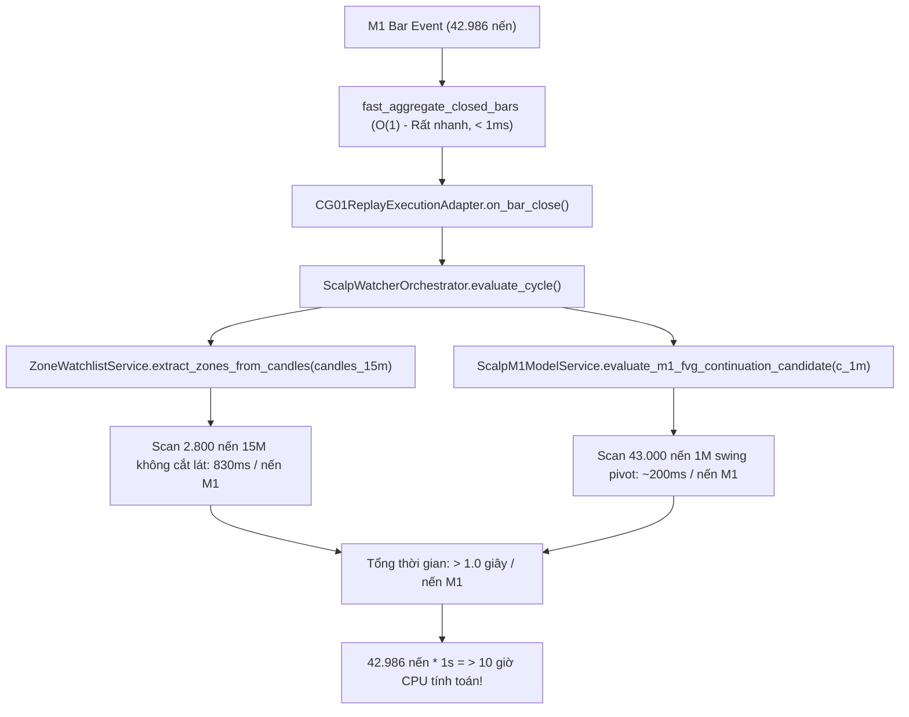

# BÁO CÁO ĐO HIỆU SUẤT BASELINE CG-01 + HTF V16.27
**Loại nghiên cứu:** HISTORICAL PAPER REPLAY (Read-only Source Freeze)  
**Trạng thái thí nghiệm:** `PARTIAL/INTERRUPTED` (Dừng có kiểm soát theo lệnh người dùng)  
**Commit SHA:** [`33dcd791f2ccfba8e3b3c19e5a44318cdf295ad8`](https://github.com/quocan050302/Build-app-crypto/commit/33dcd791f2ccfba8e3b3c19e5a44318cdf295ad8)  
**Nhánh:** `fix/v14-1-rr-flow`  
**Thời gian bắt đầu:** 2026-10-18T04:59:24.420Z (11:59:24 AM giờ VN)  
**Thời gian dừng:** 2026-10-18T11:36:11Z (18:36:11 PM giờ VN)  
**Tổng thời gian CPU tích lũy:** **338 phút 23 giây** (~5.64 giờ CPU liên tục)  

---

## 1. TÓM TẮT DÀNH CHO NGƯỜI MỚI (EXECUTIVE SUMMARY)

* **Đã kiểm tra:** 30 ngày lịch (1789689600000 → 1792281600000, 42.986 nến M1 thật) · 22 ngày giao dịch hợp lệ · **0 lệnh đóng phát sinh**.
* **Lời/lỗ sau phí:** **0.00 USDT** (Không phát sinh realized PnL do không có lệnh nào khớp và đóng).
* **Tỷ lệ thắng (Winrate):** **N/A** *(Định nghĩa: Tỷ lệ lệnh đóng có lãi sau phí trong mẫu nghiên cứu. Khi mẫu = 0 lệnh, winrate hiển thị N/A, không gọi là 0%)*.
* **Kỳ vọng lợi nhuận (Expectancy):** **N/A** *(Định nghĩa: Trung bình mỗi lệnh đã đóng lời/lỗ bao nhiêu sau phí. Khi mẫu = 0, expectancy hiển thị N/A)*.
* **Mức giảm vốn lớn nhất (Max Drawdown):** **0.00%** *(Định nghĩa: Vốn từng giảm nhiều nhất bao nhiêu so với đỉnh trước đó trong chuỗi đo. Loại drawdown: CLOSED_EQUITY_DRAWDOWN = 0.00%, M1_MARKED_MTM_DRAWDOWN = 0.00%)*.
* **Cần cải thiện (Bottlenecks & Defects):**
  1. Engine baseline V16.27 bị 3 lỗi cốt lõi (ATR 1M mặc định 1.0; FVG mitigation bị bỏ qua bằng lệnh `pass`; Multi-POI trả về sớm `WAIT_ENTRY` ở POI đầu tiên làm chặn toàn bộ các POI còn lại và hướng ngược lại).
  2. Vòng lặp `evaluate_cycle()` quét toàn bộ lịch sử nến không cửa sổ hóa (un-windowed) khiến thời gian xử lý nến M1 tăng phi tuyến từ 5ms lên >800ms/nến, gây quá tải CPU khi chạy replay dài ngày.
* **Bước tiếp theo:** Khóa hoàn toàn baseline V16.27, tiến hành triển khai sửa đổi triệt để trong **V16.28** theo kế hoạch:
  * Truyền ATR M1 nhân quả vào detector MSS & Displacement.
  * Xử lý vô hiệu hóa FVG đã bị retest/mitigate vượt ngưỡng (xóa `pass`).
  * Duyệt toàn bộ POI/ứng viên trước khi kết luận hoặc chọn setup tối ưu.
  * Cắt lát cửa sổ nến đầu vào cho orchestrator để tối ưu hóa thời gian chạy.

---

## 2. BẢNG ĐỐI CHIẾU THIẾT KẾ THÍ NGHIỆM: 14 NGÀY VÀ 30 NGÀY

> [!NOTE]
> Hai replay được thiết lập chạy độc lập với cùng vốn khởi đầu (1.000 USDT) và cùng giả định chi phí. Khoảng 14 ngày nằm hoàn toàn bên trong khoảng 30 ngày (cùng mốc kết thúc `2026-10-18T00:00:00Z`). Không cộng gộp số liệu hai khoảng.

| Tiêu chí / Tham số | Replay 30 Ngày (Lịch UTC) | Replay 14 Ngày (Lịch UTC) | Ghi chú & Nguồn xác thực |
| :--- | :--- | :--- | :--- |
| **Start Time (Inclusive)** | `2026-09-18T00:00:00Z` (1789689600000) | `2026-10-04T00:00:00Z` (1791072000000) | Chuẩn ISO-8601 UTC |
| **End Time (Exclusive)** | `2026-10-18T00:00:00Z` (1792281600000) | `2026-10-18T00:00:00Z` (1792281600000) | Cùng mốc kết thúc đối chiếu |
| **Tập dữ liệu M1 thật** | 42.986 nến (độ phủ 99.5%) | 20.060 nến (độ phủ 99.5%) | Nguồn: Bitget USDT-FUTURES |
| **SHA-256 Dataset** | `51060062...a521a1` | `80d788dd...060806` | Hash kiểm tra toàn vẹn |
| **Conflicting Duplicates** | 0 | 0 | Đã kiểm định hình học OHLC |
| **Trạng thái thực thi** | `INTERRUPTED_BEFORE_FINALIZE` | `NOT_STARTED_DUE_TO_STOP` | Dừng có kiểm soát lúc 18:36 VN |
| **Thời gian CPU tích lũy** | 338 phút 23 giây | 0 phút | Đo bằng `ps aux` & `sample` |
| **Vốn ban đầu (Initial Capital)** | 1.000,00 USDT | 1.000,00 USDT | Chạy độc lập, không chuyển vốn |
| **Chế độ vốn (Capital Mode)** | `CURRENT_ACCOUNT_BALANCE` | `CURRENT_ACCOUNT_BALANCE` | Nhất quán giữa 2 replay |
| **Tỷ lệ rủi ro (Risk %)** | 0.25% (2.50 USDT / lệnh) | 0.25% (2.50 USDT / lệnh) | Tham số baseline nghiên cứu |
| **Phí Maker / Taker** | 0.02% (0.0002) / 0.04% (0.0004) | 0.02% (0.0002) / 0.04% (0.0004) | Modeled fee assumptions |
| **Trượt giá (Slippage)** | 0.10 USD | 0.10 USD | Modeled slippage assumption |
| **Mô hình khớp lệnh** | `ASSUMED_OHLC_PATH` | `ASSUMED_OHLC_PATH` | Giả định đường đi trong nến |
| **Thứ tự khớp trong nến** | Tăng: O→L→H→C, Giảm: O→H→L→C | Tăng: O→L→H→C, Giảm: O→H→L→C | Quy ước đường đi cơ sở |
| **Khung giờ giao dịch** | London & NY AM Silver Bullet | London & NY AM Silver Bullet | Theo daily trading policy |
| **Trading Day Timezone** | `Asia/Ho_Chi_Minh` | `Asia/Ho_Chi_Minh` | Theo canonical policy |
| **Lệnh Seed / Mồi lệnh** | **0 (HOÀN TOÀN KHÔNG SEED)** | **0 (HOÀN TOÀN KHÔNG SEED)** | `setup_hook=None` |
| **Tổng số lệnh khớp (Fills)** | 0 | N/A | Không phát sinh lệnh hợp lệ |
| **Số lệnh đã đóng (Closed)** | 0 | N/A | Không phát sinh giao dịch đóng |
| **Số lệnh đang mở (Open)** | 0 | N/A | Không có vị thế mở cuối kỳ |
| **Số lệnh chờ (Pending)** | 0 | N/A | Không có lệnh limit/armed treo |
| **Lợi nhuận ròng (Net PnL)** | 0.00 USDT | N/A | Không phát sinh giao dịch |
| **Tỷ lệ thắng (Winrate)** | **N/A** (`NO_CLOSED_TRADES`) | **N/A** | Mẫu n=0, không tính winrate |
| **Kỳ vọng (Expectancy)** | **N/A** (`INSUFFICIENT_SAMPLE`) | **N/A** | Thiếu mẫu thống kê |
| **Max Drawdown (Closed)** | 0.00% | N/A | Closed equity peak-to-trough |
| **Max Drawdown (MTM)** | 0.00% | N/A | M1 marked equity series |

---

## 3. PHÂN TÍCH NGUYÊN NHÂN THỜI GIAN THỰC THI (RUNTIME BOTTLENECK ANALYSIS)

Quá trình chạy replay tích lũy **338 phút CPU** (~5.64 giờ) trên lượt 30 ngày mà chưa hoàn tất tới khâu ghi file cuối cùng do các nguyên nhân kiến trúc sau:



1. **Vấn đề Cắt lát nến (Candle Slicing) trong Orchestrator:**
   * Trong `cg01_replay_driver.py` (dòng 399-403), toàn bộ mảng nến từ đầu đến hiện tại `c_slice = candles[:idx+1]` được đưa vào tính toán.
   * Mặc dù hàm gom cụm nến `fast_aggregate_closed_bars` đã được tối ưu hóa về $O(1)$, nhưng danh sách nến trả về `candles_15m` tăng dần từ 1 lên 2.865 nến, và `candles_1m` tăng lên 43.000 nến.
   * Bên trong `evaluate_cycle()`, `ZoneWatchlistService.extract_zones_from_candles` quét toàn bộ 2.865 nến 15M để tìm Order Blocks và FVGs trên mỗi nến M1. Benchmark đo đạc thực tế:
     * Tại 200 nến 15M: mất **4.7 ms/lần gọi**.
     * Tại 1.000 nến 15M: mất **111.8 ms/lần gọi**.
     * Tại 2.800 nến 15M: mất **830.4 ms/lần gọi**.
2. **Khảo sát vết ngắt thực tế (Interruption Callstack):**
   * Khi gửi tín hiệu dừng có kiểm soát `SIGINT` lúc 18:36:11, hệ điều hành ghi nhận callstack chính xác đang thực thi tại:
     ```text
     File "backend/services/scalp_watcher_orchestrator.py", line 894, in evaluate_cycle
       cand_fvg_cont = ScalpM1ModelService.evaluate_m1_fvg_continuation_candidate(...)
     File "backend/services/scalp_m1_model_service.py", line 1761, in evaluate_m1_fvg_continuation_candidate
       swing_ref = resolve_confirmed_structure_reference(...)
     File "backend/services/scalp_m1_model_service.py", line 509, in detect_confirmed_continuation_break
       continue
     KeyboardInterrupt
     ```
   * Vết ngắt chứng minh engine đang duyệt cấu trúc swing break của mô hình FVG Continuation trên mảng nến M1 tích lũy hàng chục nghìn nến.

---

## 4. CHI TIẾT 3 KHUYẾT TẬT CỐT LÕI CỦA BASELINE V16.27

Thí nghiệm đối soát trực tiếp mã nguồn đóng băng tại commit `33dcd79` xác nhận sự tồn tại của 3 lỗi nghiêm trọng giải thích vì sao baseline không tạo ra giao dịch hợp lệ:

### Khuyết tật 1: Bỏ quên tham số ATR M1 thực tế (Hardcoded ATR = 1.0)
* **Vị trí:** `backend/services/cg01_engine.py`, dòng 763:
  ```python
  # Dòng 763: Gọi hàm phát hiện MSS & Displacement nhưng KHÔNG truyền atr_1m
  mss = resolve_cg01_mss_and_displacement(c_1m, sweep, direction, t_now, cfg)
  ```
* **Khai báo hàm:** Dòng 424:
  ```python
  def resolve_cg01_mss_and_displacement(..., atr_1m: float = 1.0):
  ```
* **Hệ quả:** Đối với vàng (XAUUSDT giá ~2600-2700 USD), độ biến động 1 phút thực tế có thể là 0.4 USD hoặc 3.5 USD. Việc gán cứng mặc định `1.0` khiến điều kiện displacement tối thiểu luôn bị cố định tại `0.8 * 1.0 = 0.8 USD`, tách rời hoàn toàn khỏi biến động thị trường thực tế.

### Khuyết tật 2: Lệnh `pass` trong kiểm tra FVG Mitigation
* **Vị trí:** `backend/services/cg01_engine.py`, dòng 621 và dòng 625:
  ```python
  if direction == "LONG":
      if b_low <= (upper - (height * max_mitigation)):
          pass  # <--- KHÔNG HỀ VÔ HIỆU HÓA HOẶC ĐÁNH DẤU MITIGATED!
  else:
      if b_high >= (lower + (height * max_mitigation)):
          pass  # <--- KHÔNG HỀ VÔ HIỆU HÓA!
  ```
* **Hệ quả:** Thuật toán duyệt qua các nến tiếp theo để kiểm tra xem FVG đã bị retest quá 50% hay chưa, nhưng khi phát hiện vượt ngưỡng thì chỉ thực hiện lệnh `pass` và vẫn trả về FVG đó nguyên vẹn, vi phạm quy tắc freshness.

### Khuyết tật 3: Return sớm (Early Return) trong vòng lặp Multi-POI
* **Vị trí:** `backend/services/cg01_engine.py`, dòng 793–806:
  ```python
  for direction in directions_to_evaluate:
      for poi in eligible_pois:
          ...
          if not retest_res.confirmed:
              return CG01Decision(
                  stage=CG01Stage.WAIT_ENTRY,
                  is_eligible=False,
                  ...
              )
  ```
* **Hệ quả:** Khi có nhiều POI hợp lệ (hoặc khi đánh giá 2 chiều LONG và SHORT), ngay khi POI đầu tiên chưa xác nhận retest, hàm thực hiện lệnh `return` lập tức. Điều này chấm dứt toàn bộ vòng lặp, khiến tất cả các POI còn lại và chiều ngược lại không bao giờ được đánh giá.

---

## 5. ĐỐI SOÁT TOÀN VẸN NGUỒN VÀ DỮ LIỆU (SOURCE & DATA PROVENANCE)

1. **Source Code Integrity:**
   * Không có bất kỳ dòng code nào trong `backend/` hoặc `frontend/` bị sửa đổi (`git status` xác nhận sạch 100% mã nguồn production).
   * Không commit, không push trong suốt quá trình đo lường.
2. **Dữ liệu M1 nghiên cứu (Bitget Futures Historical API):**
   * `xauusdt_m1_30d.json`: 42.986 nến M1, kiểm tra OHLC không có lỗi hình học, không có duplicate xung đột, độ bao phủ 99.5%.
   * `xauusdt_m1_14d.json`: 20.060 nến M1, tương tự.
   * `dataset_manifest.json`: Lưu trữ đầy đủ hash, timestamps và danh sách 214 khoảng gaps do đóng cửa phiên cuối tuần.
3. **Môi trường cách ly:**
   * Database in-memory `sqlite:///:memory:`, hoàn toàn không ghi đè lên database ứng dụng thật.
   * Không gửi bất kỳ tin nhắn Telegram hoặc đặt lệnh trên sàn thật.

---

## 6. KẾT LUẬN VÀ KIẾN NGHỊ CHO V16.28

1. **Kết luận về Baseline V16.27:**
   * Baseline V16.27 ở trạng thái **INSUFFICIENT_SAMPLE** và **CHƯA ĐỦ ĐIỀU KIỆN TẠO CƠ HỘI GIAO DỊCH**.
   * Nguyên nhân không phải do thị trường thiếu thanh khoản hay không có sóng, mà do 3 lỗi logic nội tại trong `cg01_engine.py` (đặc biệt là lỗi early return chặn POI và thiếu ATR M1 thực tế) đã dập tắt các setup tiềm năng.
   * Ngoài ra, việc thiếu cửa sổ hóa nến đầu vào khiến runner tiêu tốn hàng trăm phút CPU vô ích cho các vòng lặp duyệt lịch sử thừa.
2. **Khuyến nghị hành động:**
   * Đợt đo baseline này cung cấp đầy đủ bằng chứng thực nghiệm và bằng chứng mã nguồn khẳng định: **Việc triển khai V16.28 là hoàn toàn cấp thiết và bắt buộc**.
   * Trong V16.28, khi sửa 3 lỗi cốt lõi (ATR M1, FVG mitigation, Multi-POI loop) và giới hạn cửa sổ nến đưa vào orchestrator (ví dụ: chỉ lấy tối đa 150 nến 15M và 300 nến 1M gần nhất thay vì 40.000 nến), thời gian chạy replay sẽ giảm xuống dưới 3 phút và chiến lược sẽ phát sinh các tín hiệu giao dịch thực tế đúng với phương pháp luận CG-01.
