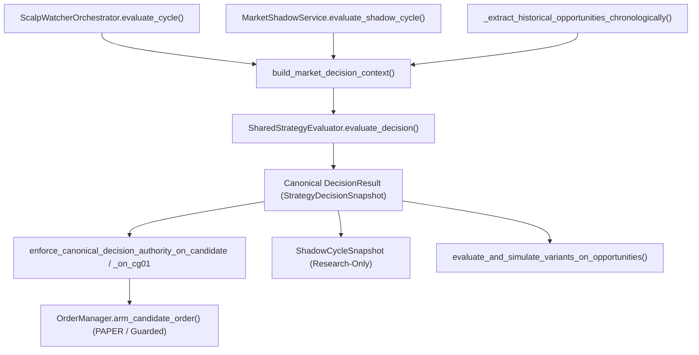

# V17.9.0.1.2 — Authoritative Runtime Call-Chain (After V17.9.0.1.2 Final Closure)

- **Final Code SHA (`FINAL_CODE_SHA`):** `ab3e82f376c0f0324571bf4b0b7405771f31559d`
- **Evaluator Version:** `17.9.0.1.1`

## 1. Unified Canonical Strategy Decision Call Graph

## 2. Runtime Entrypoint Inventory
| Runtime Path | Entrypoint | Canonical Evaluator Method | Post-Call Authority Guard | Execution Boundary |
|---|---|---|---|---|
| **Production (`ScalpWatcherOrchestrator`)** | `backend/services/scalp_watcher_orchestrator.py::evaluate_cycle` | `SharedStrategyEvaluator.evaluate_decision` | `enforce_canonical_decision_authority_on_candidate` / `enforce_canonical_decision_authority_on_cg01` + `reconcile_consumed_decisions_from_snapshots` | `OrderManager.arm_candidate_order` (requires `canonical_decision_id` & `canonical_decision_fingerprint`) |
| **`MARKET_SHADOW` (`MarketShadowService`)** | `backend/services/market_shadow_service.py::evaluate_shadow_cycle` | `SharedStrategyEvaluator.evaluate_decision` | `_evaluate_single_model_shadow` + `compare_production_shadow_divergence` (`EXACT_MATCH` / `INPUT_MISMATCH` / `DECISION_DIVERGENCE`) | `ZERO_TRADING_AUTHORITY` (read-only research) |
| **Historical Backtest (`v17_8_backtest_runner`)** | `backend/services/v17_8_backtest_runner.py::_extract_historical_opportunities_chronologically` | `SharedStrategyEvaluator.evaluate_decision` | `execute_chronological_backtest_window_for_parity` + `reconcile_backtest_trade_decision_lineage` | Offline historical simulation (`authoritative_production_parity_simulation` + `A/B/C/D` research) |
