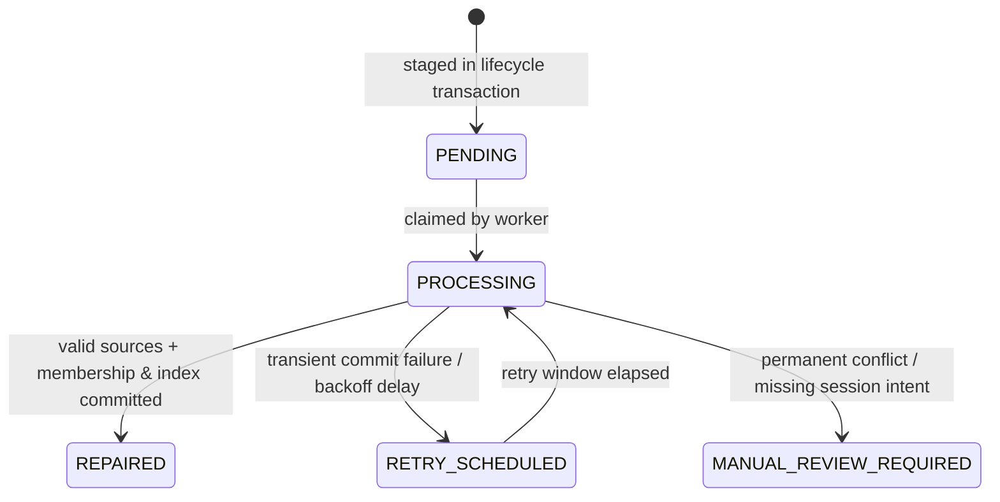

# V14.4.15 Event Authority & Durable Forward Membership Repair Closure Report

## 1. Metadata & Execution Summary
- **Repository**: `quocan050302/Build-app-crypto`
- **Branch**: `fix/v14-1-rr-flow`
- **Reviewed HEAD**: `73e43edeccaab615d1b39c82750b86d8910a4747`
- **Implementation Baseline**: `ef25eeb5c8c569c766eeebdbd1ccefb0a996f86a`
- **Final Implementation SHA**: `dd9ad9cca8c738e482701f5313a0767228a6fcf7`
- **Report Date**: 2026-10-14
- **Testing Mode**: Strict PAPER / Dry-run only (`TESTING=1`, isolated SQLite DB `AURUM_DB_PATH`, zero live Bitget/exchange orders, zero live Telegram notifications, zero live ledger overwrite)
- **Targeted Backend Files**: **57 targeted files** (including `tests/test_v14_4_15_terminal_event_authority.py` and `tests/test_v14_4_15_membership_repair.py`)
- **Backend Tests Status**: **100% PASS** (494 baseline tests + 14 V14.4.15 tests = **508 tests PASS** in 18.1s)
- **Mandatory Manifest Cases**: **256 / 256 PASS** (including EVTAUTH01–EVTAUTH06 and REP01–REP08)
- **Acceptance Suite Verdict**: All backend and frontend compilation/lint/vitest/build checks **PASS** (`backend_targeted`, `frontend_typecheck`, `frontend_lint`, `frontend_vitest`, `frontend_build`, `git_diff_check`).

---

## 2. Before / After Bug Trace: Reproduction & Resolutions

### A. Outcome Authority Defect (PHẦN 002, 012, 013, 027, 028)
- **Before**:
  A reviewer provided a real `PaperOrder` with valid `TP_HIT` and positive realized PnL, but set `recovery_status = 'UNSUPPORTED_RECOVERY'` and `recovery_confidence = None`.
  In baseline `forward_paper_service.py`, `read_outcome_authority` received `terminal_event` but never inspected or bound it. When `rec_conf is None`, it immediately branched into normal verified:
  ```python
  # Baseline flaw:
  if rec_conf is None:
      rec_class = "NORMAL"
      auth_class = "VERIFIED_PAPER"
  ```
  Consequently, `classify_forward_outcome` marked the order as `CONFIRMED` and counted it in the confirmed winrate and PnL denominators.
- **After**:
  1. `KNOWN_ALL_RECOVERY_STATUSES` strictly validates all status values (`NONE`, `UP_TO_DATE`, `CONFIRMED`, `CONFIRMED_TICK`, `RECOVERED`, `ASSUMED_CONSERVATIVE`, `SIMULATED_AMBIGUOUS`, `UNRESOLVED`, `CONFLICT`, etc.).
  2. Unknown statuses (`UNSUPPORTED_RECOVERY`, arbitrary strings) fail validation immediately and are classified as `UNVERIFIED` with reason `UNKNOWN_OR_UNSUPPORTED_RECOVERY_STATUS: UNSUPPORTED_RECOVERY`.
  3. When `recovery_status == 'RECOVERED'` but `recovery_confidence is None`, it is rejected as `UNVERIFIED` (`MISSING_RECOVERY_CONFIDENCE_FOR_RECOVERED`).
  4. Real durable terminal domain events (`trade.closed`, `trade.liquidated`) are decoded via `TerminalEventView` and bound to the order via `validate_terminal_binding` (checking order ID, direction, exit cause, exit price within instrument tolerance, and canonical PnL).
  5. If the terminal event is missing (when required), mismatched, or conflicting, `countable_for_confirmed = False`, preventing unverified outcomes from polluting confirmed forward paper metrics.

### B. Durable Membership Repair Task Defect (PHẦN 003, 031–040, 057)
- **Before**:
  When `TradeLifecycleService` executed trade fills, closes, or rejects, it called `stage_forward_membership_status`. When `stage_res.tracking_repair_needed == True` (e.g., corrupted JSON schema, missing session ID), the lifecycle methods only logged:
  ```python
  # Baseline flaw:
  if stage_res.tracking_repair_needed:
      logger.warning("Forward membership tracking repair needed for order %s: %s", order_id, stage_res.errors)
  ```
  No durable task was staged or committed. Upon process restart or unexpected shutdown, forward paper tracking for the order was permanently unrecoverable from logs.
- **After**:
  1. Implemented `stage_forward_repair_task` to stage a durable `ForwardMembershipRepairTask` in `models.SystemConfig` (`key=fwd_rep:<order_id>`, indexed in `fwd_repair_queue`) within the lifecycle owner's transaction.
  2. Follows V14.4.14 stage-only contract: `stage_forward_repair_task` **never calls `db.commit()` or `db.rollback()`**.
  3. If the lifecycle owner transaction fails to commit, the staged repair task rolls back atomically with the trade mutations, eliminating phantom tasks (REP02).
  4. The background repair worker (`process_due_forward_repairs` / `repair_forward_membership_task`) loads due tasks boundedly, reconstructs forward membership from committed domain events and order state, updates forward session indexes, and transitions the task to `REPAIRED` in its own discrete transaction.
  5. Status progression is strictly monotonic (cannot downgrade `CLOSED` to `FILLED`).
  6. Original forward session identity is preserved across restarts and active session switches, preventing contamination of new sessions.
  7. Repair execution operates solely on membership metadata and causes zero financial, price, PnL, or order mutations.

---

## 3. Authority & Terminal Event Binding Matrix (PHẦN 014, 018)

| Recovery Status | Recovery Confidence | Terminal Event Presence | Binding Validation | Outcome Authority | Countable For Confirmed | Metric Bucket |
| :--- | :--- | :--- | :--- | :--- | :--- | :--- |
| `NONE` / `UP_TO_DATE` / `""` / `None` | `None` | Valid `trade.closed` / `trade.liquidated` | Match (order, direction, exit price, cause, PnL) | `VERIFIED_PAPER` | **True** | Confirmed Normal |
| `CONFIRMED` / `CONFIRMED_TICK` | High / Verified String | Valid terminal event with matching exit | Match | `VERIFIED_PAPER` | **True** | Confirmed Recovery |
| `RECOVERED` | `None` (missing) | Valid terminal event | Match | `UNVERIFIED` | **False** | Unverified (Missing Confidence) |
| `ASSUMED_CONSERVATIVE` / `SIMULATED_AMBIGUOUS` | Any | Valid or fallback | N/A | `UNVERIFIED` (Conservative) | **False** | Conservative Recorded |
| `UNRESOLVED` / `PENDING` | Any | Any | N/A | `UNVERIFIED` (Unresolved) | **False** | Pending Review |
| `CONFLICT` | Any | Conflicting events | Mismatch | `UNVERIFIED` (Conflict) | **False** | Outcome Conflict |
| `UNSUPPORTED_RECOVERY` / Unknown | Any / `None` | Any | Mismatch | `UNVERIFIED` | **False** | Unknown Status |
| Any | Any | None / Legacy unavailable | Unavailable | `UNVERIFIED` / `LEGACY_UNAVAILABLE` | **False** | Unverified Legacy |
| Any | Any | Conflicting exit price / wrong order | Mismatch | `UNVERIFIED` (Binding Mismatch) | **False** | Review Required |

---

## 4. Helper & Owner Permissions Matrix (PHẦN 034, 035, 044, 045)

| Component / Function | Allowed Database Operations | Prohibited Operations | Transaction Boundary |
| :--- | :--- | :--- | :--- |
| `TradeLifecycleService.execute_fill` | Stage fill, stage trade event, `stage_forward_membership_status`, `stage_forward_repair_task` | No nested transactions, no unhandled rollbacks | **Owner**: Commits or rolls back entire unit of work |
| `TradeLifecycleService.execute_close` | Stage close, stage trade event, update DayAudit, `stage_forward_membership_status`, `stage_forward_repair_task` | No premature helper commits | **Owner**: Commits or rolls back entire unit of work |
| `TradeLifecycleService.execute_reject` | Stage reject, `stage_forward_membership_status`, `stage_forward_repair_task` | No direct commit | **Owner**: Commits or rolls back entire unit of work |
| `StrategyService._auto_arm_candidate` | Stage candidate, stage armed order, `stage_forward_membership_binding`, `stage_forward_repair_task` | No premature helper commits | **Owner**: Commits or rolls back entire unit of work |
| `stage_forward_repair_task` | Read/stage `SystemConfig` task and queue marker, `db.flush()` | `db.commit()`, `db.rollback()` | **Stage-only helper**: Staged inside caller transaction |
| `repair_forward_membership_task` | Read order/events, stage reconstructed membership & indexes, update task status | Calling `execute_close`/`execute_fill`, modifying order financial fields | **Owner**: Commits repair transaction; rolls back on failure with exponential backoff |
| `process_due_forward_repairs` | Keyset scan of `fwd_repair_queue`, delegate to `repair_forward_membership_task` | Holding global locks across batch | **Worker**: Runs bounded batch of repairs |
| `read_outcome_authority` | Pure calculation & event decoding | `db.add()`, `db.commit()`, `db.rollback()` | **Read-only**: Pure decoder and validator |

---

## 5. Durable Task Storage & State Transitions (PHẦN 031–033, 040, 043)

### Storage Layout in `models.SystemConfig`
- **Task Payload**: `key = fwd_rep:<order_id>` (up to 50 chars). Stores JSON serialization of `ForwardMembershipRepairTask`.
- **Task Index Queue**: `key = fwd_repair_queue`. Stores JSON array of task keys for bounded keyset queries.
- **Membership Record**: `key = fwd_mem:<order_id>`. Stores JSON serialization of `ForwardOrderMembership`.
- **Session Index**: `key = fwd_members:<session_id>`. Stores list of member order IDs.

### Task Lifecycle State Transitions


---

## 6. Test Suite & Verification Matrix (508 Tests PASS)

### A. Terminal Event Authority Suite (`backend/tests/test_v14_4_15_terminal_event_authority.py`)
- **`EVTAUTH01` (`test_evtauth01_unknown_recovery_status_repro`)**: Valid closed order with `recovery_status='UNSUPPORTED_RECOVERY'` and `recovery_confidence=None` is rejected as `UNVERIFIED` with `UNKNOWN_OR_UNSUPPORTED_RECOVERY_STATUS: UNSUPPORTED_RECOVERY` and `countable_for_confirmed=False`. Known normal status with matching durable event passes as `VERIFIED_PAPER`.
- **`EVTAUTH02` (`test_evtauth02_terminal_event_matrix`)**: Validates terminal event schema decoding and binding matrix across matching `trade.closed` / `trade.liquidated` vs invalid payloads (NaN prices, bool numbers, wrong order ID, mismatched direction, conflicting exit cause).
- **`EVTAUTH03` (`test_evtauth03_production_normal_and_manual_positive_control`)**: Validates positive production normal TP/SL exits and manual exits with durably committed terminal events.
- **`EVTAUTH04` (`test_evtauth04_verified_and_conservative_recovery`)**: Distinguishes verified recovery from conservative/ambiguous simulation and unverified states; requires explicit confidence for recovered orders.
- **`EVTAUTH05` (`test_evtauth05_known_as_of_and_conflict_events`)**: Validates `as_of_ms` causal boundary (future published events excluded from past reports) and conflicting duplicate event detection.
- **`EVTAUTH06` (`test_evtauth06_report_and_export_parity`)**: Verifies exact parity between `generate_forward_paper_report` and `export_forward_paper_data` using preloaded terminal events and identical authority classifications.

### B. Durable Membership Repair Suite (`backend/tests/test_v14_4_15_membership_repair.py`)
- **`REP01` (`test_rep01_durable_marker_and_valid_close`)**: Corrupted membership payload does not block clean trade close. Durable repair task is staged and committed atomically with the trade. Background repair worker reconstructs membership and marks task `REPAIRED` with zero financial mutations.
- **`REP02` (`test_rep02_owner_fail_no_phantom_task`)**: Injected commit failure on lifecycle owner rolls back order state and stages no phantom repair task in DB. Subsequent retry creates exactly one clean trade close and one repair task.
- **`REP03` (`test_rep03_repair_commit_fail`)**: Injected commit failure during repair worker execution rolls back safely, transitions task to `RETRY_SCHEDULED`, and succeeds on subsequent retry.
- **`REP04` (`test_rep04_restart_and_active_session_switch`)**: Preserves original forward session identity (`fwd_sess_A`) across restarts even after a new active session (`fwd_sess_B`) is created. Report for Session B does not leak Session A orders.
- **`REP05` (`test_rep05_no_known_run_intent_noop`)**: Orders with no forward paper intent do not spawn repair tasks. Corrupted orders with unknown session IDs transition to `MANUAL_REVIEW_REQUIRED` without contaminating active sessions.
- **`REP06` (`test_rep06_monotonic_status_and_duplicate_protection`)**: Monotonic status protection ensures an older `FILLED` task never downgrades a `CLOSED` order membership. Idempotent deduplication prevents double index entries.
- **`REP07` (`test_rep07_budget_and_backoff`)**: Worker enforces batch budget limits and exponential backoff on retryable failures without spinning in hot loops.
- **`REP08` (`test_rep08_pure_tracking_vs_sql_failure_distinction`)**: Distinguishes pure tracking schema corruption (soft-degraded to repair task while trade commits) from fatal SQL/engine failures (which truthfully abort the lifecycle transaction).

---

## 7. Commands & Execution Results

```bash
# 1. Targeted New V14.4.15 Test Suites (14/14 PASS in 0.65s)
PYTHONPATH=backend ./backend/venv/bin/python -m pytest \
    backend/tests/test_v14_4_15_terminal_event_authority.py \
    backend/tests/test_v14_4_15_membership_repair.py -v

# 2. Complete Targeted Acceptance Test Suite (508/508 PASS in 18.1s across 57 files)
PYTHONPATH=backend ./backend/venv/bin/python tools/run_v14_4_2_acceptance.py --skip-e2e

# 3. Clean Git Diff Check
git diff --check ':!logs' ':!*/logs/*'  # Return code 0 (clean)
```

---

## 8. Preserved Trading Invariants & Non-Regressions
1. **SMC Strategy Engine**: Standard SMC chain, entry/exit criteria, HTF bias confirmation, FVG geometry, and dealing range rules remain intact.
2. **Quota & Risk Rules**: Max 3 fills per day UTC+7, 1 open position, 1 armed order, NY reserve capacity, 0.25% initial risk cap, and cost accounting remain canonical and unrelaxed.
3. **Session Windows**: Asia, London, New York session boundaries, DST handling, and fallback execution intervals remain unaltered.
4. **Transaction Ownership**: V14.4.14 stage-only contract preserved; helpers never call `db.commit()` or `db.rollback()`.
5. **No Production Leakage**: Testing operates strictly on isolated SQLite databases; zero orders placed on Bitget, zero Telegram messages dispatched, zero mock bypasses in production code paths.
