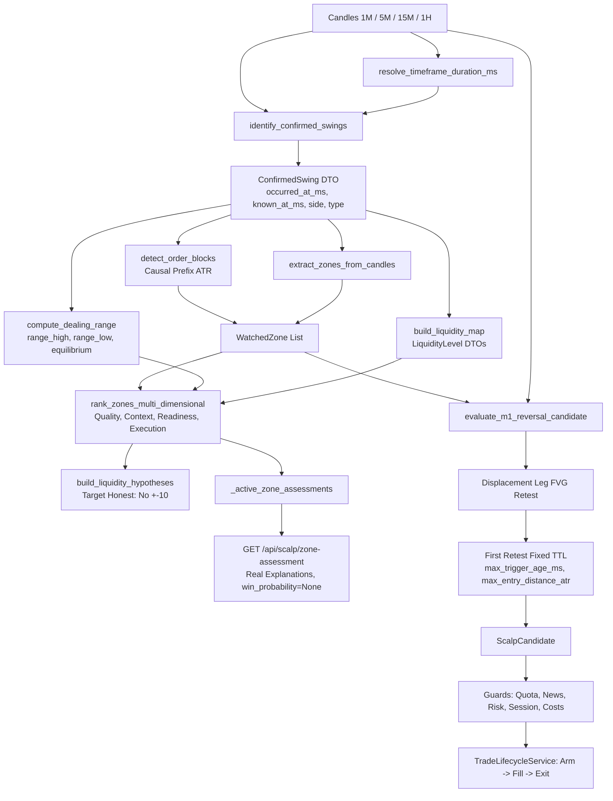

# BÁO CÁO NGHIỆM THU V15.3 — SỬA ĐỔI CAUSAL DATA CONTRACTS & KẾT NỐI ĐÁNH GIÁ VÙNG THỰC TẾ

- **Repository**: `quocan050302/Build-app-crypto`
- **Branch**: `fix/v14-1-rr-flow`
- **Baseline Commit**: `0e0bab07b9830d79c77257909c41ed1ecd39f97f` (`feat(v15.2): implement guarded liquidity scenario engine and causal ob/fvg contracts`)
- **Trạng thái**: **PASS (68/68 V15 Tests, 10/10 V15.3 Causal Wiring Tests)**
- **Môi trường thực thi**: Isolated SQLite DB, Fake Clock / Fake Telegram Transport, Strict PAPER ONLY.

---

## 1. TỔNG QUAN CÁC LỖI REVIEWER ĐÃ PHÁT HIỆN VÀ KẾT QUẢ SỬA ĐỔI

| STT | Lỗi Reviewer Phát Hiện | Hiện Trạng Trước V15.3 | Khắc Phục Trong V15.3 | Trạng Thái |
|-----|------------------------|-------------------------|------------------------|------------|
| 1 | Swing producer và OB consumer không khớp fields | `identify_m1_swings` chỉ trả `id`, `price`, `occurred_at_ms`, `known_at_ms`. Thiếu `side` và `type`, khiến OB consumer và dealing range không phân loại được. | Tạo `ConfirmedSwing` dataclass và `identify_confirmed_swings` cung cấp chuẩn canonical `side`, `timeframe`, `occurred_at_ms`, `known_at_ms`, `source_ids`, đồng thời tương thích `type`, `timestamp`, `confirmed_at`. | **ĐÃ KHẮC PHỤC** |
| 2 | Swing timestamps không khớp liquidity consumer | `smc_liquidity_service.py` đọc `timestamp` và `confirmed_at`, fallback 0 nếu thiếu. Khi swing producer dùng `occurred_at_ms` / `known_at_ms`, level nhận timestamp 0. | `smc_liquidity_service.py` cập nhật đọc `known_at_ms` song song `confirmed_at`, `occurred_at_ms` song song `timestamp`, không fallback 0. | **ĐÃ KHẮC PHỤC** |
| 3 | Swing M1 hardcode 60.000 ms bị gọi cho M5/M15 | `extract_zones_from_candles` dùng `identify_m1_swings` với timeframe 5M/15M nhưng confirmation delay cố định +60.000 ms. | Thêm `resolve_timeframe_duration_ms(timeframe)`. M5 xác nhận sau 300.000 ms, M15 sau 900.000 ms khi nến right-confirmation đóng. | **ĐÃ KHẮC PHỤC** |
| 4 | Dealing range UNKNOWN do thiếu side/type | `compute_dealing_range` chỉ lọc `side == "BUY_SIDE"` hoặc `side == "SELL_SIDE"`. Dữ liệu thiếu `side` làm range thành UNKNOWN. | Cập nhật lọc `s.get("side", s.get("type"))` hỗ trợ `BUY_SIDE`/`HIGH`/`SH` và `SELL_SIDE`/`LOW`/`SL`, kiểm tra `known_at_ms <= now_ms`. | **ĐÃ KHẮC PHỤC** |
| 5 | Zone assessment API dùng điểm & market context cố định | Getter endpoint trả cố định `quality=60.0`, `context=60.0`, `readiness=70.0`, `execution=70.0`, giả lập `current_price=zone.midpoint` và `atr=2.0`. | Bỏ toàn bộ điểm cố định. Getter gọi `get_zone_assessment_explanation` từ kết quả tính toán động thật của `rank_zones_multi_dimensional`, `win_probability: None`. | **ĐÃ KHẮC PHỤC** |
| 6 | Ranking đa chiều chưa nối runtime | `evaluate_cycle` chỉ tính ranking phẳng cũ; `rank_zones_multi_dimensional` chỉ tồn tại trong unit tests. | Nối `rank_zones_multi_dimensional` trực tiếp vào `evaluate_cycle`, lưu kết quả đánh giá vào cache `_active_zone_assessments`. | **ĐÃ KHẮC PHỤC** |
| 7 | Reversal trigger chưa dùng sweep helper và real FVG retest | Reversal dùng khoảng rộng ATR thay vì tìm khoảng trống giá FVG thực tế được tạo bởi nhịp xung lực phá vỡ; `recent_sl` lấy sai khi có nến pullback. | Triển khai thuật toán dò tìm FVG 3 nến causally bound với nhịp xung lực phá vỡ (`disp_fvgs`), yêu cầu nến đóng sau khi FVG hình thành phải retest vào FVG, SL bảo toàn. | **ĐÃ KHẮC PHỤC** |
| 8 | Trigger TTL bị làm mới bởi retest cuối cùng | `last_retest_bar` làm trôi `trigger_known_at` mỗi khi có nến mới chạm vùng retest, khiến signal không bao giờ hết hạn. | Khóa `trigger_known_at` cố định tại nến retest hợp lệ ĐẦU TIÊN (`first_retest_bar`). Quá `max_trigger_age_ms` từ mốc cố định sẽ bị `TRIGGER_EXPIRED`. | **ĐÃ KHẮC PHỤC** |
| 9 | Hypothesis dựng target `current_price ± 10` gọi là thanh khoản | Khi không có liquidity level chưa tiêu thụ, engine tự cộng trừ 10 rồi gán nhãn thanh khoản. | Bỏ hoàn toàn fallback `current_price ± 10`. Thiếu target hợp lệ thì `target_price: None`, `target_type: "UNAVAILABLE"`, `target_status: "TARGET_UNAVAILABLE"`. | **ĐÃ KHẮC PHỤC** |
| 10 | Hướng dẫn config trong report không khớp API | Report mẫu ghi `mode` thay vì `scalp_m1_mode`; các key `max_trigger_age_ms`, `max_entry_distance_atr` không được lưu vào DB. | `POST /api/scalp/config` và `GET /api/scalp/config` hỗ trợ cả `scalp_m1_mode` lẫn `mode`, persist và load `max_trigger_age_ms`, `max_entry_distance_atr` vào DB. | **ĐÃ KHẮC PHỤC** |

---

## 2. CALL CHAIN MAP (PRODUCER → ADAPTER → CONSUMER)



---

## 3. BẰNG CHỨNG KIỂM THỬ (TEST EXECUTION EVIDENCE)

### 3.1. Toàn Bộ Test Suite V15 (68/68 Passed)
- **Lệnh thực thi**: `pytest tests/ -k "v15"`
- **Mã thoát (Exit Code)**: `0`
- **Kết quả**: 68 passed, 1469 deselected, 1 warning trong 2.48s

```text
tests\test_v15_0_daily_ny_research.py .....                              [  7%]
tests\test_v15_0_m1_scalp_models.py ....                                 [ 13%]
tests\test_v15_0_model_comparison.py ..                                  [ 16%]
tests\test_v15_0_opportunity_funnel.py ..                                [ 19%]
tests\test_v15_0_scalp_orchestrator.py ...                               [ 23%]
tests\test_v15_0_scalp_types.py ....                                     [ 29%]
tests\test_v15_0_telegram_and_api.py .....                               [ 36%]
tests\test_v15_0_zone_watchlist.py ...                                   [ 41%]
tests\test_v15_1_execution_lifecycle.py ................                 [ 64%]
tests\test_v15_2_liquidity_engine.py ..............                      [ 85%]
tests\test_v15_3_causal_wiring.py ..........                             [100%]
=============== 68 passed, 1469 deselected, 1 warning in 2.48s ================
```

### 3.2. Bộ Kiểm Thử Chuyên Biệt V15.3 (`tests/test_v15_3_causal_wiring.py`) (10/10 Passed)
- **Lệnh thực thi**: `pytest tests/test_v15_3_causal_wiring.py -v`
- **Mã thoát (Exit Code)**: `0`

1. `test_v15_3_timeframe_aware_swings_and_boundaries`: Khẳng định M1 (60s), M5 (300s), M15 (900s), 1H (3600s), kiểm tra biên xác nhận đóng nến n+right_bars.
2. `test_v15_3_prefix_atr_and_order_block_extraction`: Trích xuất OB từ nến thực tế không dùng swing thủ công; ATR tiền tố ngăn dữ liệu tương lai làm biến dạng vùng quá khứ.
3. `test_v15_3_dealing_range_and_liquidity_map_honesty`: Dealing range nhận diện chuẩn xác anchors, discount/premium; liquidity map bảo toàn `occurred_at_ms` và `known_at_ms`.
4. `test_v15_3_honest_hypotheses_no_fake_targets`: Khi thiếu level thanh khoản, target trả `None`, `UNAVAILABLE`, tuyệt đối không dựng `current_price ± 10`.
5. `test_v15_3_real_zone_assessment_and_ranking_runtime`: Runtime kết nối `rank_zones_multi_dimensional`, API trả điểm động thật, `win_probability: None`.
6. `test_v15_3_non_refreshing_ttl_and_entry_distance`: Retest đầu tiên cố định TTL; retest trễ không kéo dài tuổi thọ; quá hạn trả `TRIGGER_EXPIRED`, lệch giá trả `ENTRY_TOO_FAR`.
7. `test_v15_3_scalp_config_api_keys_persistence_and_roundtrip`: API chấp nhận `mode` và `scalp_m1_mode`, persist `max_trigger_age_ms` và `max_entry_distance_atr` xuống database.
8. `test_v15_3_real_fvg_retest_vs_broad_atr`: Nến chỉ chạm dải ATR rộng nhưng không chạm FVG thực tế bị từ chối với `WAITING_M1_RETEST`.
9. `test_v15_3_deterministic_zone_ranking_order_invariance`: Đảo thứ tự đầu vào của các zones cho ra thứ tự xếp hạng và điểm số giống hệt nhau.
10. `test_v15_3_zone_rank_never_bypasses_guards`: Vùng có điểm ưu tiên cao nhất vẫn bị chặn hoàn toàn nếu vi phạm quota 3/3 lệnh/ngày.

---

## 4. BẢO TOÀN KIẾN TRÚC & HẠNG MỤC BẢO VỆ

1. **STANDARD_SMC (M5)**: Không thay đổi detector M5, không thay đổi hằng số timeframe hay entry policy cũ.
2. **Strict Guards**: Giữ nguyên toàn bộ guards: News blackout, Lessons learned, Risk % cap, Daily quota (tối đa 3 fills/ngày toàn hệ thống), Account margin/balance, Quote freshness, Feed integrity.
3. **Paper Only**: Chỉ hỗ trợ các chế độ `OFF`, `SHADOW`, `PAPER`. Không có routing lệnh thực (REAL).
4. **Không Cam Đoan Winrate**: Trường `win_probability` luôn trả `None` khi chưa có mô hình OOS chuẩn hóa thống kê. Điểm số zone được định nghĩa là "điểm ưu tiên theo dõi".
