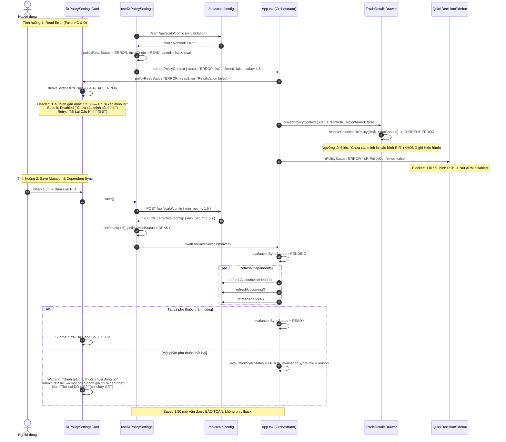

# AURUM V16.39.20 — IMPLEMENTATION MAP
**Khép Trạng Thái R:R Từ Settings Đến Drawer & Nghiệm Thu Điều Kiện ARM**
*Mã phiên bản:* V16.39.20  
*Branch:* `fix/v14-1-rr-flow`  
*Baseline SHA:* `5f1880a9105fc88965140e2144c01a95e0bbb1e1` (Commit: `fix(v16.39.19): preserve RR error states and verify settings save propagation`)  

---

## 1. Bản Đồ Hàm & Biểu Tượng Thực Tế (Implementation Inventory)

| Tệp / Thành phần | Ký hiệu / Hàm | Trạng thái | Input Contract | Output / Hành vi thực tế | Callers sản xuất | Test bảo vệ |
| :--- | :--- | :--- | :--- | :--- | :--- | :--- |
| `frontend/src/components/RrPolicySettingsCard.tsx` | `deriveSettingsRrDisplay` | **MỚI** | `{ saved: RrPolicySaved, policyReadStatus?: PolicyReadStatus }` | Trả về `SettingsRrDisplay` với `mode: 'LOADING' \| 'READY' \| 'READ_ERROR' \| 'UNCONFIRMED'`. Khi `READ_ERROR`, heading là *"Cấu hình gần nhất"* (nếu có lastKnown) hoặc *"Chưa xác minh cấu hình"*; `canClaimSynchronized = false`. | `RrPolicySettingsCard` (dòng 139) | `v16_39_20_rr_ui_state.test.tsx` (C1, C4) |
| `frontend/src/components/RrPolicySettingsCard.tsx` | `RrPolicySettingsCardProps` | **MỞ RỘNG** | Interface props | Bổ sung `policyReadStatus`, `errorOrigin`, `readError`, `saveError`, `evaluationSyncStatus`, `evaluationSyncError`, `onRetryRead`, `onRetrySync`. | `App.tsx` (dòng 2928) | `v16_39_20_rr_ui_state.test.tsx` (C1, C2, C3, C4, C5) |
| `frontend/src/components/RrPolicySettingsCard.tsx` | Header & Submit Logic | **SỬA** | Dựa trên `displayInfo`, `errorOrigin`, `evaluationSyncStatus` | - **READ_ERROR**: Header hiển thị *"Cấu hình gần nhất: 1:x.xx — Chưa xác minh lại"*; Submit button disabled với nhãn *"Chưa xác minh cấu hình"*; Nút retry gọi `onRetryRead` (*"Tải Lại Cấu Hình"*). - **SAVE_ERROR**: Giữ nguyên `saved` confirmed cũ (*"Đang áp dụng: 1:x.xx"*); giữ `draftText` dirty; Submit button cho phép lưu lại. - **SYNC_PENDING / ERROR**: Submit hiển thị *"Đang cập nhật đánh giá..."* hoặc *"Một phần đánh giá chưa cập nhật"*; có nút *"Thử Lại Đồng Bộ"*. | Form render | `v16_39_20_rr_ui_state.test.tsx` (C1, C2, C5) |
| `frontend/src/components/TradeDetailsDrawer.tsx` | `formatDrawerRrPolicyThreshold` | **MỚI** | `view: SelectionRrPolicyView` | Định dạng chuỗi hiển thị ngưỡng tối thiểu: - `ORDER_SNAPSHOT KNOWN`: `1:x.xx (Lúc ARM)` - `ORDER_SNAPSHOT INVALID`: `Ngưỡng snapshot lúc ARM không hợp lệ` - `ORDER_SNAPSHOT MISSING`: `Chưa lưu ngưỡng lúc ARM` - `CURRENT ERROR`: `Chưa xác minh lại cấu hình R:R` - `CURRENT READY`: `1:x.xx (Hiện hành)` - `CURRENT LOADING`: `Đang tải cấu hình R:R...` | `TradeDetailsDrawer` (dòng 898) | `v16_39_20_rr_ui_state.test.tsx` (D1, D2, D3, D4, D5) |
| `frontend/src/components/TradeDetailsDrawer.tsx` | `TradeDetailsDrawerProps` | **MỞ RỘNG** | Interface props | Bổ sung prop `currentPolicyContext?: CurrentPolicyContext \| null`. | `App.tsx` (dòng 1770) | `v16_39_20_rr_ui_state.test.tsx` (D1-D5) |
| `frontend/src/components/TradeDetailsDrawer.tsx` | Drawer RR Resolution Boundary | **SỬA** | `(selectedIntent, currentPolicyContext !== undefined ? currentPolicyContext : legacyFallback)` | Nhận trực tiếp `currentPolicyContext` từ App owner (chứa `status`, `isConfirmed`, `policyReadStatus`), không để lọt ERROR hay fallback số cũ che giấu lỗi. | `TradeDetailsDrawer` (dòng 887) | `v16_39_20_rr_ui_state.test.tsx` (D1) |
| `frontend/src/App.tsx` | `onRrPolicySavedRef` & `onSaveSuccess` bridge | **SỬA** | `Ref<((saved: RrPolicySaved) => void \| Promise<void>) \| null>` | Wrapper trả về `return onRrPolicySavedRef.current?.(saved)`. Cho phép `useRrPolicySettings.save()` await hoàn tất refresh phụ thuộc mà không nuốt completion. | Hook khởi tạo (dòng 446) | `v16_39_20_rr_ui_state.test.tsx` (W1) |
| `frontend/src/App.tsx` | `evaluationSyncStatus` & `evaluationSyncError` | **MỚI** | React state `('IDLE' \| 'PENDING' \| 'READY' \| 'ERROR')` | Theo dõi quá trình đồng bộ các dependents sau Save mà không làm thay đổi trạng thái canonical của policy đã lưu. | `handleRrPolicySaved`, `handleRetrySync` | `v16_39_20_rr_ui_state.test.tsx` (C5) |
| `frontend/src/App.tsx` | Dependent Refresh Functions | **SỬA** | `refreshAccountAndHealth`, `refreshUpcoming`, `refreshAnalysis` | Trả về `Promise<{ ok: boolean; reason?: string }>`. Bắt lỗi nội bộ không ném unhandled rejection cho timer/polling callers cũ nhưng báo cáo chính xác kết quả cho orchestrator. | Polling effects, socket handlers, Save orchestrator | `v16_39_20_rr_ui_state.test.tsx` (C5, W1) |
| `frontend/src/App.tsx` | `handleRrPolicySaved` | **SỬA** | `(saved: RrPolicySaved) => Promise<void>` | Đặt `evaluationSyncStatus: 'PENDING'`. Gọi đồng thời qua `Promise.allSettled`. Nếu có promise rejected hoặc `{ ok: false }`, đặt `evaluationSyncStatus: 'ERROR'` với lý do cụ thể; nếu tất cả thành công, đặt `READY`. Không rollback `saved` policy. | `onRrPolicySavedRef` | `v16_39_20_rr_ui_state.test.tsx` (W1) |
| `frontend/src/App.tsx` | `handleRetrySync` | **MỚI** | `() => Promise<void>` | Cơ chế thử lại đồng bộ đánh giá phụ thuộc (chỉ thực hiện GET), không gửi lại mutation POST. | `RrPolicySettingsCard.onRetrySync` | `v16_39_20_rr_ui_state.test.tsx` (C5) |
| `backend/tests/e2e_server.py` | Fixture `MID_LONG` & `e2e-mid-long` | **MỚI** | Setup có entry=2650.0, sl=2640.0, tp=2668.0 | Tạo setup có actual Net R:R = 1.75 (nằm giữa ngưỡng 1.50 và 2.50) theo công thức production. | `_reset(db)` trong test server | `v16_39_20_rr_policy_acceptance.e2e.ts` (E01) |
| `frontend/src/__tests__/v16_39_20_rr_ui_state.test.tsx` | Unit & Component Suite | **MỚI** | 12 tests production component tree | Kiểm chứng chi tiết Failure C1-C5, Failure D1-D5, Async Callback Bridge W1, Sidebar Gate W2. | Vitest runner | `npm test` |
| `frontend/tests/e2e/v16_39_20_rr_policy_acceptance.e2e.ts` | Browser Acceptance Spec | **MỚI** | 2 tests Playwright (Full Flow & Mobile) | Nghiệm thu 2 lần Save (1.50 và 2.50) trong cùng một SPA document (token `__RR_V20_DOC__`), kiểm chứng setup 1.75 chuyển từ MET sang NOT_MET, Drawer phản ánh Hiện hành, order frozen giữ 2.00 Lúc ARM. | Playwright runner | `npx playwright test` |

---

## 2. Luồng Dữ Liệu Đồng Bộ & Cô Lập Lỗi (Dataflow Architecture)

---

## 3. Ma Trận Trạng Thái Giao Diện (UI State Verification Matrix)

| Kịch Bản Context | RrPolicySettingsCard | TradeDetailsDrawer (CURRENT DRAFT) | TradeDetailsDrawer (ORDER KNOWN 2.0) | QuickDecisionSidebar | CG01DiagnosticCard Badge |
| :--- | :--- | :--- | :--- | :--- | :--- |
| **CURRENT READY (1:1.50)** | Header: *Đang áp dụng: 1:1.50* Submit: *R:R Đã Đồng Bộ (1:1.50)* | *1:1.50 (Hiện hành)* | *1:2.00 (Lúc ARM)* | Guard R:R đánh giá bình thường (MET với actual 1.75) | `1:1.50` (Màu vàng kim) |
| **CURRENT ERROR (có lastKnown 1.50)** | Header: *Cấu hình gần nhất: 1:1.50 — Chưa xác minh lại* Submit: *Chưa xác minh cấu hình* (disabled) Nút: *Tải Lại Cấu Hình* | *Chưa xác minh lại cấu hình R:R* (Tuyệt đối KHÔNG ghi Hiện hành) | *1:2.00 (Lúc ARM)* (Độc lập, không bị lỗi current làm mất) | Blocker: *Lỗi cấu hình R:R* Nút ARM disabled an toàn | `Lỗi tải cấu hình` (Màu đỏ/hổ phách) |
| **CURRENT ERROR (chưa có lastKnown)** | Header: *Chưa xác minh cấu hình* Submit: *Chưa xác minh cấu hình* (disabled) | *Chưa xác minh lại cấu hình R:R* | *1:2.00 (Lúc ARM)* | Blocker: *Lỗi cấu hình R:R* Nút ARM disabled an toàn | `Lỗi tải cấu hình` |
| **SAVE ERROR (sau READY 1.50, draft 2.50)** | Header: *Đang áp dụng: 1:1.50* Alert: *Lưu cấu hình thất bại: ... Bản nháp được giữ nguyên.* Submit: *Lưu R:R (1:2.50)* | *1:1.50 (Hiện hành)* (Giữ cấu hình đã xác minh cũ) | *1:2.00 (Lúc ARM)* | Đánh giá theo ngưỡng cũ 1.50 (MET với actual 1.75) | `1:1.50` |
| **POST-SAVE SYNC PENDING** | Header: *Đang áp dụng: 1:x.xx* Submit: *Đã lưu — đang cập nhật đánh giá...* | *1:x.xx (Hiện hành)* | *1:2.00 (Lúc ARM)* | Chờ dữ liệu phân tích | `1:x.xx` |
| **POST-SAVE SYNC ERROR** | Alert: *Đánh giá phụ thuộc chưa đồng bộ* Submit: *Đã lưu — một phần đánh giá chưa cập nhật* Nút: *Thử Lại Đồng Bộ* | *1:x.xx (Hiện hành)* | *1:2.00 (Lúc ARM)* | Giữ trạng thái phụ thuộc gần nhất | `1:x.xx` |
| **ORDER SNAPSHOT MISSING** | Không áp dụng (thuộc view Order) | N/A | *Chưa lưu ngưỡng lúc ARM* | N/A | N/A |
| **ORDER SNAPSHOT INVALID** | Không áp dụng (thuộc view Order) | N/A | *Ngưỡng snapshot lúc ARM không hợp lệ* | N/A | N/A |

---

## 4. Xác Nhận Bất Biến Tài Chính & Kỹ Thuật

1. **Công thức & Guards:** Giữ nguyên 100% công thức `calculateClientRiskReward`, phí sàn 0.05% và trượt giá. Không nới lỏng các guards session, news, account, lessons.
2. **Không Thay Đổi Hình Học Lệnh:** Khi Save ngưỡng 1.50 hoặc 2.50, `rebaseDraftRrPolicy` chỉ rebase context compliance, tuyệt đối không di chuyển Entry, StopLoss, TakeProfit hoặc đảo hướng lệnh LONG/SHORT.
3. **Bảo Toàn Lệnh Lịch Sử:** Snapshot của lệnh đã ARM/OPEN/CLOSED giữ nguyên tính bất biến.
4. **Cô Lập Môi Trường:** Kiểm thử E2E sử dụng SQLite tạm của `backend/tests/e2e_server.py`, không kết nối sàn Bitget, không gửi Telegram thật.
