# AURUM V16.39.21 — IMPLEMENTATION MAP
**Khép Nghiệm Thu R:R: Fixture Canonical, Browser Assertions Bắt Buộc, Báo Cáo Có Bằng Chứng**
*Mã phiên bản:* V16.39.21  
*Branch:* `fix/v14-1-rr-flow`  
*Baseline SHA:* `e3817e1488aafcf6574e791d556e04a562691134` (Commit: `fix(v16.39.20): propagate RR verification state to settings and drawer`)  

---

## 1. Bản Đồ Hàm & Biểu Tượng Thực Tế (Implementation Inventory)

| Tệp / Thành phần | Ký hiệu / Hàm | Trạng thái | Input Contract | Output / Hành vi thực tế | Callers sản xuất / test | Test bảo vệ |
| :--- | :--- | :--- | :--- | :--- | :--- | :--- |
| `backend/tests/e2e_financial_helper.py` | `_calculate_e2e_plan_financials` | **MỚI** | `(direction, entry, sl, tp, capital=1000.0, risk_pct=0.25, min_net_rr=1.5, leverage=5, margin_mode='ISOLATED')` | Gọi trực tiếp `domain_calculator.calculate_risk_reward` thật với `CostAssumptions()`. Từ chối geometry không hợp lệ (`is_valid == False` -> raise `ValueError`). Trả về `CalculationResult` canonical. | `e2e_server.py::_upsert_setup` | `test_v16_39_21_e2e_financial_fixtures.py` (5 tests) |
| `backend/tests/e2e_server.py` | `PLANS['MID_LONG']` & `PLANS['MID_SHORT']` | **SỬA** | Dictionaries cấu hình giá fixture | `MID_LONG`: entry=2650.0, sl=2640.0, tp=2674.0 (actual Net R:R = 1.7677).<br>`MID_SHORT`: entry=2650.0, sl=2660.0, tp=2626.0 (actual Net R:R = 1.7681). Cả hai đều nằm trong khoảng $(1.50, 2.50)$. | `_reset(db)` trong test server | `test_v16_39_21_e2e_financial_fixtures.py`, `v16_39_21_rr_final_acceptance.e2e.ts` |
| `backend/tests/e2e_server.py` | `_upsert_setup` | **SỬA** | `(db, setup_id, direction, state, entry, sl, tp, ...)` | **BỎ CÔNG THỨC GIẢ** `row.net_rr = round(row.gross_rr - 0.05, 2)`. Gọi `_calculate_e2e_plan_financials` để tính `gross_rr` và `net_rr` bằng domain calculator production thật. | `_reset(db)` | `test_v16_39_21_e2e_financial_fixtures.py` |
| `backend/tests/e2e_server.py` | `_reset` | **SỬA** | `(db: Session)` | Seed đầy đủ cả `e2e-mid-long` (LONG) và `e2e-mid-short` (SHORT) theo canonical plans mới, cùng các fixtures cũ (`LONG`, `SHORT`, `TIGHT_SHORT`). | `POST /__e2e/reset` | `v16_39_21_rr_final_acceptance.e2e.ts`, `v16_39_20_rr_policy_acceptance.e2e.ts` |
| `frontend/src/components/QuickDecisionSidebar.tsx` | Selection DOM Attributes | **MỞ RỘNG** | Header card trong `QuickDecisionSidebar` | Bổ sung `data-testid="sidebar-selected-setup"`, `data-selected-id={selectedId}`, `data-selected-direction={selectedIntent.direction}`. | Render component | `v16_39_21_rr_observability.test.tsx`, Playwright spec |
| `frontend/src/components/QuickDecisionSidebar.tsx` | Price DOM Attributes | **MỞ RỘNG** | Anchor price spans (Entry, SL, TP) | Bổ sung `data-testid="sidebar-entry-price"`, `data-testid="sidebar-sl-price"`, `data-testid="sidebar-tp-price"`. | Render component | `v16_39_21_rr_observability.test.tsx`, Playwright spec |
| `frontend/src/components/QuickDecisionSidebar.tsx` | Details Button Locator | **MỞ RỘNG** | Nút `onOpenDetailsDrawer('quality')` | Bổ sung `data-testid="sidebar-open-trade-details"` trên button thật, thay thế selector giả định `open-trade-details-drawer-btn`. | Render component | `v16_39_21_rr_observability.test.tsx`, Playwright spec |
| `frontend/src/components/QuickDecisionSidebar.tsx` | R:R Status Observability | **MỞ RỘNG** | Hàng hiển thị Net R:R | Bổ sung `data-testid="sidebar-net-rr-row"`, `data-rr-status={rrComparison.status}`, `data-rr-actual={rrComparison.actualNetRR}`, `data-rr-required={rrComparison.requiredMinNetRR}`. Hoàn toàn phản ánh output của `compareNetRr` production. | Render component | `v16_39_21_rr_observability.test.tsx`, Playwright spec |
| `frontend/src/components/TradeDetailsDrawer.tsx` | Threshold Value Locator | **MỞ RỘNG** | Span hiển thị `formatDrawerRrPolicyThreshold(drawerRrPolicyView)` | Bổ sung `data-testid="rr-policy-threshold-value"` phục vụ scope assertion chính xác, tránh false pass do text match toàn body. | Render component | `v16_39_21_rr_observability.test.tsx`, Playwright spec |
| `frontend/src/__tests__/v16_39_21_rr_observability.test.tsx` | Component Test Suite | **MỚI** | 6 tests Vitest component level | Kiểm chứng: QuickDecisionSidebar hiển thị đúng MET (ở 1.50) và NOT_MET (ở 2.50) cho cả LONG và SHORT; bảo toàn giá geometry; TradeDetailsDrawer hiển thị `1:1.50 (Hiện hành)`, `1:2.50 (Hiện hành)` và `1:2.00 (Lúc ARM)`. | Vitest runner | `npm test` |
| `backend/tests/test_v16_39_21_e2e_financial_fixtures.py` | Pytest Fixture Preflight | **MỚI** | 5 tests Pytest | Kiểm chứng: MID_LONG đạt ~1.768R, MID_SHORT đạt ~1.768R, metamorphic test ngưỡng 1.5/2.5 không đổi geometry và actual Net R:R, từ chối geometry sai, chứng minh baseline 2668 chỉ đạt 1.28R. | Pytest runner | `pytest` |
| `frontend/tests/e2e/v16_39_21_rr_final_acceptance.e2e.ts` | Final Strict Acceptance Spec | **MỚI** | 3 tests Playwright (LONG, SHORT, MOBILE) | Bắt buộc 100% assertions: loại bỏ toàn bộ `catch(() => false)` hoặc optional branches; assert window token `__RR_FINAL_DOC__`; Save 1.50 -> MET -> Drawer 1.50 -> Save 2.50 -> NOT_MET -> blocker ARM -> geometry invariance -> frozen order 2.00 -> return CURRENT 2.50 -> state outbox == 0. | Playwright runner | `npx playwright test` |
| `frontend/tests/e2e/v16_39_20_rr_policy_acceptance.e2e.ts` | Acceptance Spec Cleanup | **SỬA** | 2 tests Playwright | Thay thế toàn bộ các bước optional catch cũ bằng locators thật và assertions bắt buộc (`expect(locator).toBeVisible()`). | Playwright runner | `npx playwright test` |

---

## 2. Đính Chính Khoản Trừ Phí Net R:R (Canonical vs Mock Formula)

Trong phiên bản V16.39.20 trước đây, tệp test fixture `backend/tests/e2e_server.py::_upsert_setup` sử dụng công thức giả:
```python
# CÔNG THỨC GIẢ CŨ TRONG TEST FIXTURE (ĐÃ BỊ LOẠI BỎ HOÀN TOÀN)
risk = abs(entry - sl)
reward = abs(tp - entry)
row.gross_rr = round(reward / risk, 2) if risk > 0 else 0.0
row.net_rr = round(row.gross_rr - 0.05, 2) if row.gross_rr > 0 else 0.0
```
Khoản trừ `-0.05` này là một **hằng số giả tạo trong test fixture**, hoàn toàn không phản ánh phí giao dịch và trượt giá của calculator production.

Khi đo bằng production calculator thật (`domain_calculator.py::calculate_risk_reward`) với thông số:
- Capital = 1000 USDT, Risk = 0.25% (2.5 USDT), Leverage = 5, Margin Mode = ISOLATED
- `CostAssumptions()`: Maker 0.02%, Taker 0.04%, Slippage 0.10 USDT

| Kịch Bản | Entry | SL | TP | Gross R:R | Công Thức Cũ (Fake) | Calculator Thật (Canonical) | Kết Quả Ngưỡng 1.50 |
| :--- | :--- | :--- | :--- | :--- | :--- | :--- | :--- |
| **Cũ (Baseline)** | 2650.0 | 2640.0 | 2668.0 | 1.80 | 1.75R | **1.2807R** | **KHÔNG ĐẠT (NOT_MET)** |
| **Mới (LONG Canonical)** | 2650.0 | 2640.0 | 2674.0 | 2.40 | N/A | **1.7677R** | **ĐẠT (MET)** ($1.7677 > 1.50$) |
| **Mới (SHORT Canonical)** | 2650.0 | 2660.0 | 2626.0 | 2.40 | N/A | **1.7681R** | **ĐẠT (MET)** ($1.7681 > 1.50$) |

Toàn bộ fixtures `MID_LONG` và `MID_SHORT` đã được cập nhật sang bộ giá canonical mới để giá trị Net R:R thực sự đạt khoảng **~1.768R**, nằm chuẩn xác giữa ngưỡng 1.50 (MET) và 2.50 (NOT_MET).

---

## 3. Kiến Trúc Kiểm Chứng Trình Duyệt Bắt Buộc (Strict Browser Acceptance Architecture)

```mermaid
flowchart TD
    A[Start: page.goto '/' duy nhất] --> B[Gắn RAM Marker window.__RR_FINAL_DOC__]
    B --> C[Save 1.50 qua Form UI]
    C --> D{Verify Response canonical 1.50}
    D --> E[selectCurrentSetupOnChart setupId]
    E --> F[Assert Geometry & Net R:R MET ở 1.50]
    F --> G[openRiskDrawer -> Assert 1:1.50 Hiện hành]
    G --> H[closeRiskDrawer -> Assert window marker]
    H --> I[Save 2.50 qua Form UI trên CÙNG document]
    I --> J{Verify Response canonical 2.50}
    J --> K[selectCurrentSetupOnChart setupId]
    K --> L[Assert GEOMETRY INVARIANT: Entry/SL/TP/Actual không đổi]
    L --> M[Assert Net R:R NOT_MET & ARM CTA Blocked do R:R]
    M --> N[openRiskDrawer -> Assert 1:2.50 Hiện hành]
    N --> O[closeRiskDrawer -> Assert window marker]
    O --> P[focusFrozenOrderOnChart ord-frozen-v20 via Journal]
    P --> Q[openRiskDrawer -> Assert 1:2.00 Lúc ARM]
    Q --> R[closeRiskDrawer -> Assert window marker]
    R --> S[selectCurrentSetupOnChart setupId]
    S --> T[openRiskDrawer -> Assert VẪN 1:2.50 Hiện hành]
    T --> U[Final Check: Marker nguyên vẹn & Outbox == 0]
```



### Các helpers kiểm thử bắt buộc (Strict E2E Helpers):
1. `selectCurrentSetupOnChart(page, setupId)`:
   - Mở tab `[data-tab-id="upcoming"]`.
   - Tìm chính xác `[data-setup-id="${setupId}"]` với `expect(card).toHaveCount(1)` và `expect(card).toBeVisible()`.
   - Click nút con `[data-testid="focus-setup-chart"]`.
   - Xác nhận selection trên Sidebar bằng `[data-testid="sidebar-selected-setup"]` với attribute `data-selected-id={setupId}`.
2. `saveMinimumThroughUi(page, value)`:
   - Mở tab `[data-tab-id="paper"]`.
   - Điền `#min-net-rr-input` giá trị (`1.50` hoặc `2.50`).
   - Đăng ký `page.waitForResponse` bắt đúng POST `/api/scalp/config`.
   - Click `button[type="submit"]`.
   - Xác minh HTTP 200, parse JSON canonical `min_net_rr == Number(value)`.
   - Xác minh thẻ cập nhật text `1:${value}`.
3. `openRiskDrawer(page)`:
   - Click nút thật `[data-testid="sidebar-open-trade-details"]`.
   - Bắt dialog bằng accessible role `getByRole('dialog', { name: 'Bảng chi tiết giao dịch và phân tích' })`.
   - Click tab `Rủi Ro`. Trả về `Locator` của drawer.
4. `closeRiskDrawer(page, drawer)`:
   - Click nút đóng `getByRole('button', { name: 'Đóng bảng chi tiết' })`.
   - Bắt buộc `await expect(drawer).toBeHidden()`.
5. `focusFrozenOrderOnChart(page, orderId)`:
   - Mở tab `[data-tab-id="journal"]`.
   - Click nút `[data-testid="journal-focus-chart"][data-order-id="${orderId}"]`.
   - Xác nhận order được focus trên chart với `OPEN_POSITION` intent.
6. `assertSameDocument(page, marker)`:
   - Đọc `Reflect.get(window, '__RR_FINAL_DOC__')`.
   - So sánh bằng `expect(currentToken).toBe(marker)`.

---

## 4. Bất Biến Kiểm Chứng (Guarantees & Invariants)

1. **Invariance of Geometry:**
   Việc lưu cấu hình R:R tối thiểu toàn hệ thống chỉ thay đổi ngưỡng đánh giá (`requiredMinNetRR`), hoàn toàn **KHÔNG LÀM THAY ĐỔI** giá vào lệnh (`plannedEntry`), cắt lỗ (`stopLoss`), chốt lời (`takeProfit`), hướng lệnh (`direction`) hay tỷ lệ thực tế sau phí (`actualNetRR`).
2. **Snapshot Isolation:**
   Lệnh lịch sử đã đóng (`ord-frozen-v20`) lưu ngưỡng lúc ARM trong `cost_snapshot` (`1:2.00 Lúc ARM`). Việc thay đổi ngưỡng Current toàn ứng dụng (1.50 -> 2.50) tuyệt đối không ghi đè lên snapshot này, và việc xem lệnh lịch sử cũng không làm rò rỉ snapshot ngược lại cấu hình Current.
3. **Fail-Closed Arm Blocker:**
   Khi actual Net R:R (1.768) < ngưỡng yêu cầu (2.50), nút Submit CTA trên Sidebar bị khóa (`data-can-submit="false"`), aria-label nêu rõ lý do tỷ lệ R:R chưa đạt yêu cầu 1:2.50.
