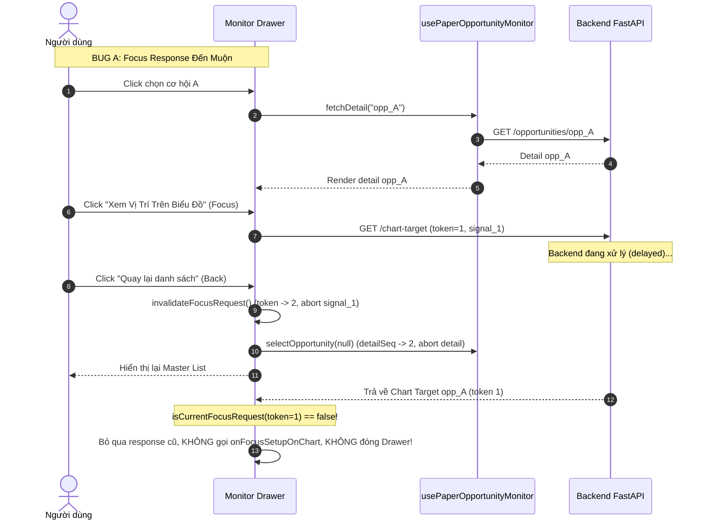

# AURUM V17.2 — MONITOR FINAL IMPLEMENTATION MAP
**Sửa Request Races, Revision Provenance, Time Window Cutoff và Run Binding Của Forward Paper Opportunity Monitor**

- **Repository:** `quocan050302/Build-app-crypto`
- **Branch:** `fix/v14-1-rr-flow`
- **Baseline SHA:** `135370a0bc1fb86ba2a1557af97dd9ee500c479e`
- **Commit Message:** `fix(v17.1): bind monitor query scope and hydrate canonical chart targets`
- **Phiên bản hoàn thành:** Aurum V17.2

---

## 1. Bản Đồ Hàm & Thành Phần Thực Sự Triển Khai (Source Truth Mapping)

| Tệp Nguồn | Tên Hàm / Helper | Bản Chất | Callers & Wiring Thực Tế | Vai Trò & Hợp Đồng Kỹ Thuật (Input / Output) | Test Chứng Minh |
| :--- | :--- | :--- | :--- | :--- | :--- |
| `frontend/src/types/paperOpportunityMonitor.ts` | `BoundMonitorQuery` | **MỚI** | `paperOpportunityText.ts`, `usePaperOpportunityMonitor.ts`, `PaperOpportunityMonitorDrawer.tsx` | Kiểu dữ liệu TypeScript mở rộng của `ResolvedMonitorQuery`, bảo đảm các trường `run_id`, `start_ms`, `end_ms`, `query_key` luôn là `string`/`number` non-null, không để null fallback làm unscoped downstream request. | `tsc -b`, `npm test` |
| `frontend/src/types/paperOpportunityMonitor.ts` | `MonitorResolution` | **MỚI** | `asResolvedMonitorQuery`, `fetchOverviewData` | Discriminated union (`RESOLVED` \| `EMPTY_SCOPE` \| `UNAVAILABLE` \| `INVALID`) phân loại kết quả giải quyết phạm vi quan sát từ backend summary. | `v17_2_monitor_repro.test.tsx` |
| `frontend/src/utils/paperOpportunityText.ts` | `asResolvedMonitorQuery` | **MỚI** | `usePaperOpportunityMonitor.ts::fetchOverviewData` | Nhận `OpportunityMonitorSummary`, kiểm chứng tính nhất quán giữa `query_scope.run_id`, `coverage.run_id`, `query_key`, `start_ms < end_ms` và trả về `MonitorResolution`. Chặn hoàn toàn việc bootstrap downstream khi thiếu active run. | `v17_2_monitor_repro.test.tsx` |
| `frontend/src/utils/paperOpportunityText.ts` | `toMonitorRequestParams` | **MỚI** | `usePaperOpportunityMonitor.ts` (list page 1, next pages), `PaperOpportunityMonitorDrawer.tsx` (chart focus, export report) | Pure adapter duy nhất chuyển đổi `BoundMonitorQuery` thành `MonitorQueryParams` loại bỏ cursor/limit khỏi context identity. | `v17_2_monitor_repro.test.tsx` |
| `frontend/src/utils/paperOpportunityText.ts` | `assertMonitorResponseContext` | **MỚI** | `usePaperOpportunityMonitor.ts::fetchOverviewData`, `loadNextPage` | So khớp `query_key` và `run_id` của response với context đã pin; nếu mismatch từ chối commit partial overview hoặc append page lệch run. | `v17_2_monitor_repro.test.tsx` (Probe E5) |
| `frontend/src/utils/paperOpportunityText.ts` | `formatMonitorReportFilename` | **MỚI** | `PaperOpportunityMonitorDrawer.tsx::handleDownloadReport` | Tạo tên file an toàn định dạng `paper-opportunity-report-{symbol}-{dateStart}-to-{dateEnd}.md` theo múi giờ `Asia/Ho_Chi_Minh` (+07:00). | `v17_2_monitor_repro.test.tsx` |
| `frontend/src/utils/paperOpportunityText.ts` | `validateMonitorChartFocusContext` | **SỬA** | `PaperOpportunityMonitorDrawer.tsx::handleFocusChart` | Bổ sung kiểm tra `queryKey` equality, `dto.id === target_id === expectedTargetId`, `instrument === expectedSymbol` (trên ORDER), và kiểm tra atomic price levels bằng cách tích hợp `getCanonicalSetupPlan` từ `planLevels.ts`. | `paperOpportunityText.test.ts`, `v17_2_monitor_repro.test.tsx` |
| `frontend/src/hooks/usePaperOpportunityMonitor.ts` | `fetchOverviewData` | **SỬA** | `usePaperOpportunityMonitor` lifecycle & interval | Thay thế hoàn toàn mô hình `Promise.all` song song 2 request unscoped bằng luồng tuần tự: fetch summary -> giải quyết context bằng `asResolvedMonitorQuery` -> pin `run_id` và `window` -> fetch list page 1 tường minh -> xác minh context bằng `assertMonitorResponseContext` -> commit overview nguyên cặp. | `usePaperOpportunityMonitor.test.tsx`, `v17_2_monitor_repro.test.tsx` (Probe E5) |
| `frontend/src/hooks/usePaperOpportunityMonitor.ts` | `selectOpportunity(id \| null)` | **SỬA** | Drawer row select, Back button, click backdrop | Khi `id === null` (Back/bỏ chọn), lập tức tăng `detailSequenceRef.current`, abort `detailAbortRef`, và reset `selectedOpportunityDetail` về `null`. Ngăn chặn phản hồi detail đến muộn ghi đè dữ liệu. | `v17_2_monitor_repro.test.tsx` |
| `frontend/src/components/PaperOpportunityMonitorDrawer.tsx` | `invalidateFocusRequest` | **MỚI** | `handleBackToList`, `handleSelectRow`, `requestCloseMonitor`, `useEffect` cleanup | Tăng `focusGenerationRef.current`, gọi `focusAbortControllerRef.current.abort()`, xóa ref và đưa `isFocusing` về `false`. | `v17_2_monitor_repro.test.tsx` (Probe E1), `v17_2_opportunity_monitor.e2e.ts` (Gate 2) |
| `frontend/src/components/PaperOpportunityMonitorDrawer.tsx` | `requestCloseMonitor` | **MỚI** | Nút đóng drawer (`monitor-close-btn`), backdrop click, phím Escape | Wrapper an toàn hủy focus & export request đang chạy trước khi đóng drawer, bảo đảm không rò rỉ callback. | `PaperOpportunityMonitorDrawer.test.tsx` |
| `frontend/src/components/PaperOpportunityMonitorDrawer.tsx` | `handleFocusChart` | **SỬA** | Nút "Xem Vị Trí Trên Biểu Đồ" (`monitor-focus-chart-btn`) | Bắt (capture) target ID, kind, revision, query context trước await. Gửi `expected_revision` lên API khi target là SETUP. Kiểm tra guard `isCurrentFocusRequest` trước mọi side effect (kể cả trong `catch`/`finally`). Validate DTO và callback trước khi đóng drawer. | `v17_2_monitor_repro.test.tsx` (Probe E1, E2), `v17_0_opportunity_monitor.e2e.ts` |
| `frontend/src/components/PaperOpportunityMonitorDrawer.tsx` | `handleBackToList` | **SỬA** | Nút "Quay lại danh sách" | Gọi `invalidateFocusRequest()` trước khi dọn state selection, ngăn phản hồi focus đến muộn làm nhảy chart hoặc đóng drawer. | `v17_2_monitor_repro.test.tsx` (Probe E1) |
| `backend/services/paper_opportunity_monitor_service.py` | `resolve_monitor_query_context` | **SỬA** | Tất cả monitor read services (summary, list, detail, focus, report) | Loại bỏ việc tự ý lùi 1 ngày (`max(0, requested.end_ms - 86400000)`) khi `effective_start >= requested.end_ms`. Trả về `SCOPE_MISMATCH` và `query=None` minh bạch. | `test_v17_2_monitor_context.py` (Section 120) |
| `backend/services/paper_opportunity_monitor_service.py` | `build_opportunity_monitor_detail` | **SỬA** | Endpoint GET `/opportunities/{id}` | Thêm điều kiện `timestamp_ms >= effective_query.start_ms` và `< effective_query.end_ms` vào query `PaperResearchOrderMilestone`. Ràng buộc `CG01TraceRecord` trong khoảng `[start_ms, end_ms)` và đúng `run_id`. Sắp xếp `normalized_stages` có thứ tự xác định theo `(as_of_ms, updated_at_ms, created_at_ms, stage)`. | `test_v17_2_monitor_context.py` (Probe E4) |
| `backend/services/paper_opportunity_monitor_service.py` | `build_monitor_chart_focus_context` | **SỬA** | Endpoint GET `/opportunities/{id}/chart-target` | Server tự động trích xuất recorded revision từ funnel stages và so khớp với `setup_row.version`. Kể cả khi client không truyền `expected_revision`, nếu `setup_row.version != recorded_rev` thì trả về `STALE_TARGET`. Tích hợp `resolve_plan_levels` kiểm tra atomic geometry (LONG: `sl < entry < tp`, SHORT: `tp < entry < sl`). Kiểm tra instrument khớp symbol. | `test_v17_2_monitor_context.py` (Probe E3, Matrix) |
| `backend/services/paper_opportunity_monitor_service.py` | `group_monitor_opportunities` | **SỬA** | `list_monitor_opportunities`, `build_opportunity_monitor_detail` | Bổ sung tham số `end_ms`. Ngăn chặn việc order đóng trong tương lai (`closed_at >= end_ms`) ghi đè trạng thái lịch sử của mốc quan sát thành `CLOSED`. | `test_v17_2_monitor_context.py` (Future order closure) |
| `backend/services/paper_opportunity_monitor_service.py` | `render_opportunity_monitor_markdown` | **SỬA** | Endpoint GET `/report.md` | Bổ sung tham số keyword `total_count: Optional[int] = None, has_more: bool = False`. Định dạng rõ thông báo giới hạn `*(Đang hiển thị 50/{total} cơ hội; báo cáo giới hạn 50 dòng)*` khi dữ liệu bị cắt. | `test_v17_2_monitor_context.py` (Report endpoint) |
| `backend/main.py` | `get_opportunity_monitor_report_endpoint` | **SỬA** | Endpoint GET `/api/v1/paper/opportunity-monitor/report.md` | Giải quyết `resolve_monitor_query_context` một lần duy nhất tại route; truyền `effective_ctx` tường minh sang cả `build_opportunity_monitor_summary` và `list_monitor_opportunities`. | `test_v17_2_monitor_context.py` (Report endpoint) |

---

## 2. Luồng Kiểm Soát Đua & Hủy Request (Concurrency & Invalidation Sequence)

---

## 3. Ma Trận Xử Lý Revision Ba Nguồn (Revision Tri-Source Matrix)

Theo Section 054 và Appendix C3:

| Recorded Revision (Funnel Payload) | Requested Revision (Client Params) | Persisted Version (WatchSetup DB) | Trạng Thái Phản Hồi | Mã Lý Do (`reason_code`) | Hành Vi UI |
| :--- | :--- | :--- | :--- | :--- | :--- |
| `1` | `1` | `1` | **AVAILABLE** | `AVAILABLE` | Mở setup trên biểu đồ, đóng drawer. |
| `1` | Không gửi (`None`) | `2` | **STALE_TARGET** | `SETUP_REVISION_MISMATCH` | Server tự bảo vệ; hiển thị cảnh báo kế hoạch đã đổi, giữ nguyên chart cũ. |
| `1` | `1` | `2` | **STALE_TARGET** | `SETUP_REVISION_MISMATCH` | Hiển thị cảnh báo inline, giữ nguyên chart cũ. |
| `1` | `2` (Client cố sửa) | `2` | **SCOPE_MISMATCH** | `REQUESTED_RECORDED_REVISION_MISMATCH` | Chặn mismatch, từ chối hợp thức hóa snapshot cũ bằng yêu cầu mới. |
| `None` (Legacy thiếu rev) | Bất kỳ | `1` | **UNAVAILABLE** | `SETUP_REVISION_UNVERIFIED` | Cho phép xem facts nhưng chặn focus biểu đồ với lý do rõ ràng. |
