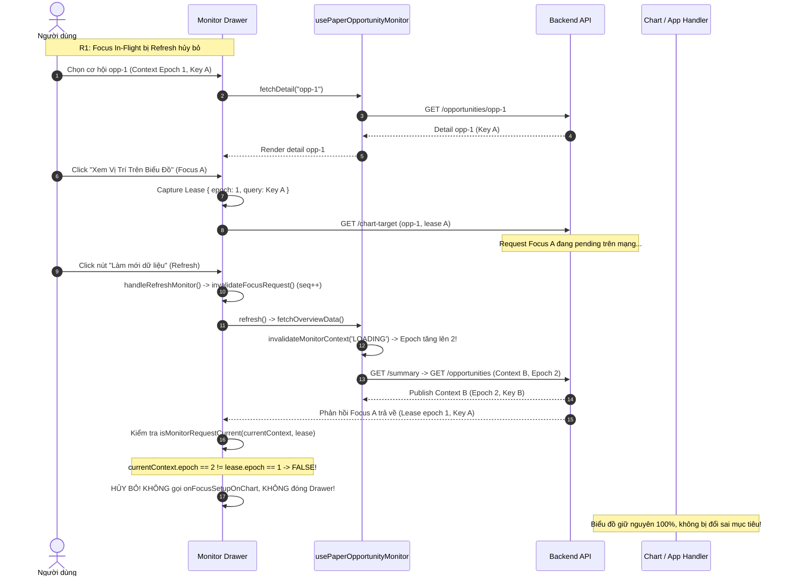
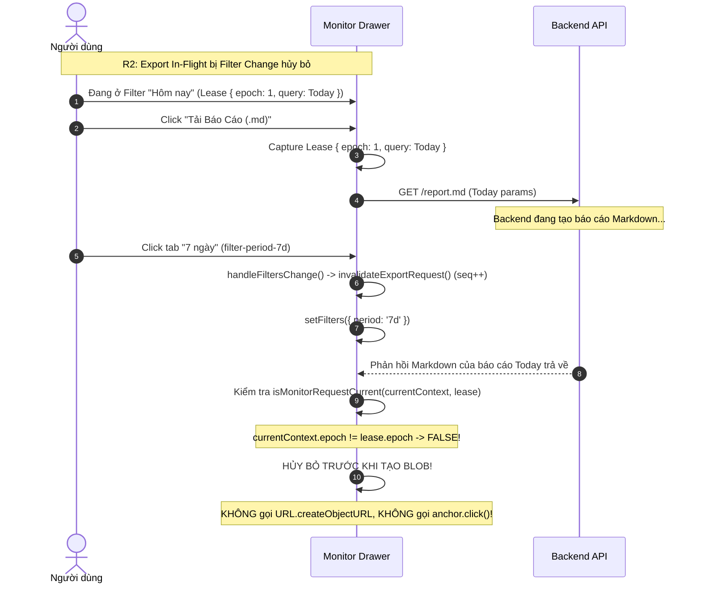
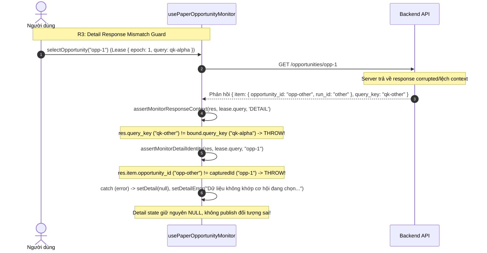

# AURUM V17.3 — MONITOR CONTEXT CLOSURE IMPLEMENTATION MAP
**Đóng Kín Vòng Đời Context, Ngăn Chặn Đua Thao Tác Focus & Export, và Xác Thực Tính Toàn Vẹn Của Detail**

- **Repository:** `quocan050302/Build-app-crypto`
- **Branch:** `fix/v14-1-rr-flow`
- **Baseline SHA:** `ec4f6aedfca9d3522f3969a0f0913a17a1280ede`
- **Baseline Commit:** `fix(v17.2): close monitor request races, enforce revision provenance, and bind temporal scope`
- **Phiên bản hoàn thành:** Aurum V17.3 — Final Monitor Context Lifecycle Closure

---

## 1. Bản Đồ Hàm & Thành Phần Thực Sự Triển Khai (Source Truth Mapping)

| Tệp Nguồn | Tên Hàm / Kiểu Dữ Liệu | Bản Chất | Callers & Wiring Thực Tế | Vai Trò & Hợp Đồng Kỹ Thuật (Input / Output) | Test Chứng Minh |
| :--- | :--- | :--- | :--- | :--- | :--- |
| `frontend/src/types/paperOpportunityMonitor.ts` | `MonitorContextSnapshot` | **MỚI** | `usePaperOpportunityMonitor.ts`, `PaperOpportunityMonitorDrawer.tsx`, `paperOpportunityText.ts` | Discriminated union (`READY` mang `epoch` và `BoundMonitorQuery`; `CLOSED` \| `LOADING` \| `UNAVAILABLE` \| `ERROR` mang `epoch`, `query: null`, optional `reason`). Ngăn chặn downstream action sử dụng query cũ khi context đang transition. | `v17_3_monitor_repro.test.tsx`, `tsc -b` |
| `frontend/src/types/paperOpportunityMonitor.ts` | `MonitorRequestLease` | **MỚI** | `captureMonitorRequestLease`, `isMonitorRequestCurrent`, `fetchDetail`, `handleFocusChart`, `handleDownloadReport` | Interface immutable token đại diện quyền thực thi action gồm `{ readonly epoch: number; readonly query: Readonly<BoundMonitorQuery> }`. | `v17_3_monitor_repro.test.tsx`, `tsc -b` |
| `frontend/src/types/paperOpportunityMonitor.ts` | `UsePaperOpportunityMonitorResult` | **SỬA** | `usePaperOpportunityMonitor.ts`, `PaperOpportunityMonitorDrawer.tsx` | Bổ sung `monitorContext: MonitorContextSnapshot` và stable getter `getCurrentMonitorContext: () => MonitorContextSnapshot`. Giữ nguyên toàn bộ fields public cũ. | `v17_3_monitor_repro.test.tsx`, `tsc -b` |
| `frontend/src/utils/paperOpportunityText.ts` | `captureMonitorRequestLease` | **MỚI** | `fetchDetail`, `loadNextPage`, `handleFocusChart`, `handleDownloadReport` | Pure helper kiểm tra snapshot `READY` và các trường `run_id`, `query_key`, `start_ms < end_ms` hữu hạn; trả về token immutable hoặc `null`. | `v17_3_monitor_repro.test.tsx` (Pure helpers suite) |
| `frontend/src/utils/paperOpportunityText.ts` | `isMonitorRequestCurrent` | **MỚI** | `fetchDetail`, `loadNextPage`, `handleFocusChart`, `handleDownloadReport` | Pure helper kiểm tra tính tươi mới của request: so khớp `status === 'READY'`, `epoch === lease.epoch` và equality tuyệt đối của toàn bộ `query_key`, `run_id`, `symbol`, `scope`, `start_ms`, `end_ms`, `session_id`, `model_id`. | `v17_3_monitor_repro.test.tsx` (Pure helpers suite) |
| `frontend/src/utils/paperOpportunityText.ts` | `assertMonitorDetailIdentity` | **MỚI** | `usePaperOpportunityMonitor.ts::fetchDetail`, `PaperOpportunityMonitorDrawer.tsx::handleFocusChart` | Pure helper kiểm tra dữ liệu detail trả về từ server: bắt buộc `item.opportunity_id === expectedOpportunityId` và `item.run_id === bound.run_id`. Ném lỗi `ID_MISMATCH` hoặc `RUN_MISMATCH` nếu sai lệch. | `v17_3_monitor_repro.test.tsx` (Probe R3) |
| `frontend/src/utils/paperOpportunityText.ts` | `assertMonitorResponseContext` | **SỬA** | `fetchOverviewData` (LIST), `loadNextPage` (LIST), `fetchDetail` (DETAIL), `handleFocusChart` (FOCUS) | Siết chặt ràng buộc khóa truy vấn: trong các path đã bound (`bound.query_key` tồn tại), phản hồi thiếu `query_key` hoặc mang `query_key` khác đều bị reject `SCOPE_MISMATCH`. | `v17_3_monitor_repro.test.tsx` (Pure helpers suite) |
| `frontend/src/hooks/usePaperOpportunityMonitor.ts` | `contextRef` & `publishMonitorContext` | **MỚI** | Hook context owner | Khởi tạo ref và state đồng bộ; khi có transition, cập nhật ref đồng bộ trước khi trigger setState để các async callback đọc qua getter thấy ngay giá trị mới. | `v17_3_monitor_repro.test.tsx` (Probe R1, R2, R3) |
| `frontend/src/hooks/usePaperOpportunityMonitor.ts` | `invalidateMonitorContext` | **MỚI** | `fetchOverviewData` (đầu cycle), `close` effect | Tăng epoch (`epoch + 1`), phát hành snapshot non-READY (`LOADING` / `CLOSED`), hủy controller và sequence của detail/page, dọn state loading của các request cũ. | `v17_3_monitor_repro.test.tsx` (Probe R1, R3) |
| `frontend/src/hooks/usePaperOpportunityMonitor.ts` | `fetchDetail(id)` | **SỬA** | `useEffect([open, selectedId, monitorContext.status, monitorContext.epoch])` | Capture lease trước khi gọi API; dùng params từ lease; sau khi nhận phản hồi gọi `assertMonitorResponseContext` và `assertMonitorDetailIdentity`; kiểm tra `isMonitorRequestCurrent` trước khi gọi `setDetail`. Nếu mismatch, set detail về `null` và hiển thị `detailError`. | `v17_3_monitor_repro.test.tsx` (Probe R3) |
| `frontend/src/hooks/usePaperOpportunityMonitor.ts` | `loadNextPage()` | **SỬA** | Nút "Tải thêm cơ hội cũ hơn" (`monitor-load-more-btn`) | Capture lease từ `getCurrentMonitorContext()`; kiểm tra freshness `isMonitorRequestCurrent` và `assertMonitorResponseContext(nextPage, lease.query, 'LIST')` trước khi merge vào state. | `PaperOpportunityMonitorDrawer.test.tsx` |
| `frontend/src/components/PaperOpportunityMonitorDrawer.tsx` | `handleRefreshMonitor` | **MỚI** | Nút làm mới (`monitor-refresh-btn`) | Wrapper gọi `invalidateFocusRequest()` và `invalidateExportRequest()` đồng bộ trước khi kích hoạt `refresh()`. | `v17_3_monitor_repro.test.tsx` (Probe R1), `v17_3_monitor_context.e2e.ts` (Gate 1) |
| `frontend/src/components/PaperOpportunityMonitorDrawer.tsx` | `handleFiltersChange` | **MỚI** | Nút Hôm nay (`filter-period-today`), 7 ngày (`filter-period-7d`), Tùy chọn (`filter-period-custom`), input `customStartDate`, `customEndDate` | Wrapper gọi `invalidateFocusRequest()` và `invalidateExportRequest()` đồng bộ trước khi kích hoạt `setFilters(updater)`. | `v17_3_monitor_repro.test.tsx` (Probe R2, Extension), `v17_3_monitor_context.e2e.ts` (Gate 2) |
| `frontend/src/components/PaperOpportunityMonitorDrawer.tsx` | Context Transition Effect | **MỚI** | `useEffect([monitorContext.epoch, monitorContext.status])` | Tự động hủy in-flight focus và export requests khi auto-refresh (timer 30s) hoặc external filter props làm thay đổi epoch/status. | `v17_3_monitor_repro.test.tsx` |
| `frontend/src/components/PaperOpportunityMonitorDrawer.tsx` | `handleFocusChart` | **SỬA** | Nút "Xem Vị Trí Trên Biểu Đồ" (`monitor-focus-chart-btn`) | Capture lease từ `getCurrentMonitorContext()`; gửi params từ lease; sau await kiểm tra `isMonitorRequestCurrent(getCurrentMonitorContext(), lease)`; validate DTO canonical; chỉ gọi chart callback và đóng drawer khi lease vẫn hoàn toàn current. | `v17_3_monitor_repro.test.tsx` (Probe R1, Positive Control), `v17_3_monitor_context.e2e.ts` (Gate 1) |
| `frontend/src/components/PaperOpportunityMonitorDrawer.tsx` | `handleDownloadReport` | **SỬA** | Nút "Tải Báo Cáo (.md)" (`monitor-download-report-btn`) | Capture lease từ `getCurrentMonitorContext()`; sau await kiểm tra `isMonitorRequestCurrent(getCurrentMonitorContext(), lease)` TRƯỚC KHI tạo Blob và gọi `anchor.click()`. | `v17_3_monitor_repro.test.tsx` (Probe R2, Positive Control), `v17_3_monitor_context.e2e.ts` (Gate 2) |

---

## 2. Luồng Xử Lý & Đóng Kín 3 Lỗi Cốt Lõi (R1, R2, R3 Lifecycles)

### R1. Ngăn chặn Focus cũ đổi chart sau Refresh

### R2. Ngăn chặn Export cũ tự tải khi đã đổi Filter

### R3. Ngăn chặn Detail sai context hoặc sai Opportunity ID

---

## 3. Ma Trận Transition & Validation Đã Kiểm Chứng

| Sự Kiện / Input | Trạng Thái Context | In-Flight Focus | In-Flight Export | In-Flight Detail | Kết Quả Phản Hồi Chậm Cũ | Hành Vi Sau Transition |
| :--- | :--- | :--- | :--- | :--- | :--- | :--- |
| **Manual Refresh** | `LOADING` (epoch++) | Bị hủy ngay tại wrapper & epoch guard | Bị hủy ngay tại wrapper & epoch guard | Bị hủy tại begin transition | Bị reject; chart & download giữ nguyên | READY với context B mới; các nút mở lại bình thường |
| **Auto Refresh (30s)** | `LOADING` (epoch++) | Bị hủy qua context effect & epoch guard | Bị hủy qua context effect & epoch guard | Bị hủy tại begin transition | Bị reject; không leak callback/blob | READY với window mới; selection re-fetch detail mới nếu còn chọn |
| **Filter Period (7d/custom)** | `LOADING` (epoch++) | Bị hủy tại filter wrapper | Bị hủy tại filter wrapper | Bị hủy tại begin transition | Bị reject; không download báo cáo cũ | Context mới giải quyết; export mới tải đúng nội dung 7d/custom |
| **Custom Date Change** | `LOADING` (epoch++) | Bị hủy tại filter wrapper | Bị hủy tại filter wrapper | Bị hủy tại begin transition | Bị reject; không download báo cáo cũ | Cập nhật ngày bắt đầu/kết thúc chính xác |
| **Back Button** | Giữ context list | Bị hủy tại `handleBackToList` | Không ảnh hưởng | Bị hủy tại `selectOpportunity(null)` | Bị reject; drawer không đóng, chart không nhảy | Trở về master list view an toàn |
| **Close Drawer / Reopen** | `CLOSED` (epoch++) | Bị hủy tại `requestCloseMonitor` | Bị hủy tại `requestCloseMonitor` | Bị hủy tại unmount/close | Bị reject; không setState sau đóng | Lần mở sau mang epoch mới, không nhận response phiên cũ |
| **Detail Response Lệch ID** | `READY` | Không thể bấm Focus vì detail `null` | Không ảnh hưởng | Reject tại `assertMonitorDetailIdentity` | Detail thành `null`, hiện lỗi inline | Người dùng thấy thông báo dữ liệu không khớp, chart được bảo vệ |
| **Detail Response Lệch Key** | `READY` | Không thể bấm Focus vì detail `null` | Không ảnh hưởng | Reject tại `assertMonitorResponseContext` | Detail thành `null`, hiện lỗi inline | Chặn hoàn toàn dữ liệu sai scope |
