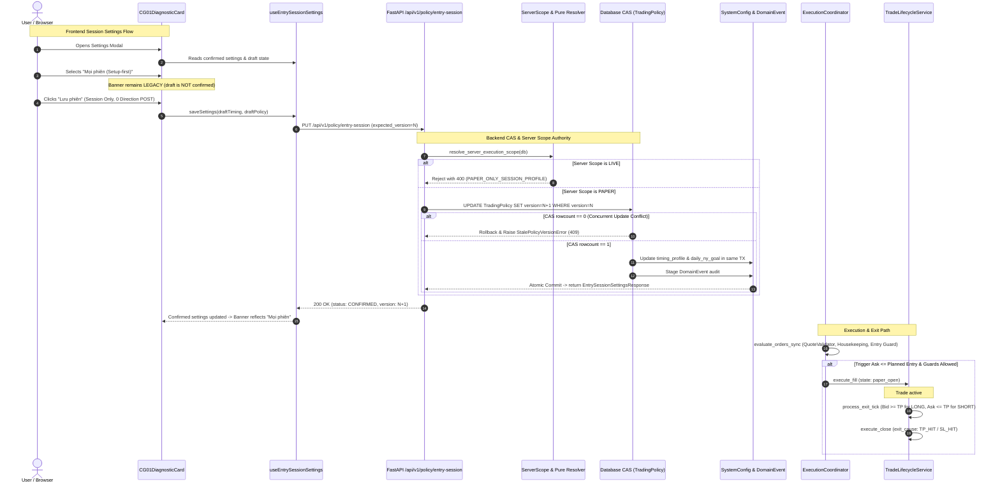

# AURUM V17.4.1 — Implementation Map & Architecture Specification

**Repository:** `quocan050302/Build-app-crypto`  
**Branch:** `fix/v14-1-rr-flow`  
**Baseline SHA:** `b09077e6cd9f06636d82892de82dd0fd97dc28b6`  
**Target Commit:** `fix(v17.4.1): confirm session settings and verify guarded fills`  
**Scope:** Session Settings / Execution Acceptance (Zero strategy alteration, zero threshold loosening, zero NY preference/reservation)

---

## 1. High-Level Call Flow Architecture

---

## 2. Component & Function Implementation Matrix

| File | Function / Symbol | Type | Callers | Contract & Invariant | Test File Reference | Status |
|---|---|---|---|---|---|---|
| `frontend/src/api/client.ts` | `getEntrySessionSettings` | [HIỆN CÓ] (Refactored) | `useEntrySessionSettings` | Path clean `/api/v1/policy/entry-session`, accepts optional `AbortSignal`, typed response | `v17_4_1_entry_session_hook.test.tsx` | VERIFIED |
| `frontend/src/api/client.ts` | `updateEntrySessionSettings` | [HIỆN CÓ] (Refactored) | `useEntrySessionSettings` | Strict `expected_version`, error status preservation | `v17_4_1_entry_session_hook.test.tsx` | VERIFIED |
| `frontend/src/hooks/useEntrySessionSettings.ts` | `useEntrySessionSettings` | [HIỆN CÓ] (Refactored) | `CG01DiagnosticCard` | Monotonic revision counters, in-flight save ref, draft dirty protection ref, abort signal | `v17_4_1_entry_session_hook.test.tsx` | VERIFIED |
| `frontend/src/components/CG01DiagnosticCard.tsx` | `CG01DiagnosticCard` | [HIỆN CÓ] (Refactored) | `App.tsx` | Connected to `useEntrySessionSettings`. Banner reads strictly confirmed settings. Split direction save from session save. | `v17_4_1_entry_session_card.test.tsx`, `v17_4_1_entry_sessions.e2e.ts` | VERIFIED |
| `backend/schemas.py` | `EntrySessionSettingsUpdate` | [HIỆN CÓ] (Hardened) | `main.py` PUT endpoint | `extra="forbid"`, `expected_version: StrictInt = Field(ge=1)`, symbol validation | `test_v17_4_1_contracts.py` | VERIFIED |
| `backend/schemas.py` | `EntrySessionSettingsResponse` | [HIỆN CÓ] | `main.py` GET/PUT | Full metadata: status, version, scope, effective goals, reason codes | `test_v17_4_1_contracts.py` | VERIFIED |
| `backend/policy_constants.py` | `ALL_SESSIONS_SETUP_FIRST`, `CG01_ALL_SESSIONS_PAPER`, etc. | [HIỆN CÓ] (Enhanced) | Backend policy & tests | Canonical constants without SQLAlchemy dependency | `test_v17_4_1_contracts.py` | VERIFIED |
| `backend/services/entry_session_policy_service.py` | `resolve_server_execution_scope` | [MỚI] | `build_entry_session_update_plan`, `main.py` | Reads authoritative server `SystemConfig.execution_scope`, rejects client override | `test_v17_4_1_server_scope.py` | VERIFIED |
| `backend/services/entry_session_policy_service.py` | `resolve_entry_session_settings` | [HIỆN CÓ] (Hardened) | `main.py` GET endpoint, tests | Pure resolver detecting corrupt goals under setup-first, returns `status="CONFLICT"` | `test_v17_4_1_contracts.py` | VERIFIED |
| `backend/services/entry_session_policy_service.py` | `EntrySessionUpdatePlan` | [MỚI] | `apply_entry_session_update_plan` | Immutable dataclass capturing validated mutation parameters | `test_v17_4_1_contracts.py` | VERIFIED |
| `backend/services/entry_session_policy_service.py` | `build_entry_session_update_plan` | [MỚI] | `apply_entry_session_update_plan`, `stage_entry_session_settings` | Normalizes and validates request against server scope and current version | `test_v17_4_1_contracts.py` | VERIFIED |
| `backend/services/entry_session_policy_service.py` | `apply_entry_session_update_plan` | [MỚI] | `update_entry_session_settings` | Database-level CAS `UPDATE ... WHERE version=expected`, upserts SystemConfig, stages audit event | `test_v17_4_1_atomic_cas.py` | VERIFIED |
| `backend/services/entry_session_policy_service.py` | `update_entry_session_settings` | [HIỆN CÓ] (Refactored) | `main.py` PUT endpoint | Transaction owner: single atomic commit on success, full rollback on CAS conflict or error | `test_v17_4_1_atomic_cas.py` | VERIFIED |
| `backend/services/trading_policy_service.py` | `update_quota_lifecycle_state` | [HIỆN CÓ] (Bugfix) | Quota lifecycle readers | Early branch for `ALL_SESSIONS_SETUP_FIRST` returns `NOT_APPLICABLE` (fixes 0/0 fulfilled bug) | `test_v17_4_1_quota_not_required.py` | VERIFIED |
| `backend/services/trading_policy_service.py` | `get_or_create_policy` | [HIỆN CÓ] (Hardened) | Entry session & trading policy services | Catches `IntegrityError` on concurrent default row creation, rolls back, re-queries | `test_v17_4_1_atomic_cas.py` | VERIFIED |
| `backend/services/quote_validator.py` | `QuoteValidator.validate_ticker` | [HIỆN CÓ] (Hardened) | `ExecutionCoordinator` | Gracefully accepts `ValidatedQuote` instances without attribute error | `test_v17_4_1_coordinator_flow.py` | VERIFIED |
| `backend/services/execution_coordinator.py` | `evaluate_orders_sync` | [HIỆN CÓ] | Test flows & orchestrator background loop | Checks quote freshness, expiry housekeeping, config version, geometry, trigger touch, entry guards | `test_v17_4_1_coordinator_flow.py`, `test_v17_4_1_coordinator_guards.py` | VERIFIED |
| `backend/services/trade_lifecycle_service.py` | `process_exit_tick` | [HIỆN CÓ] | Exit evaluator | Evaluates live bid/ask quotes against position TP/SL geometry, calls `execute_close` | `test_v17_4_1_coordinator_flow.py` | VERIFIED |

---

## 3. Transaction Ownership and Invariants

1. **Transaction Boundary:**
   `update_entry_session_settings` is the sole transaction owner. It normalizes inputs, invokes `apply_entry_session_update_plan`, stages CAS update and SystemConfig rows, stages DomainEvent audit, and calls `db.commit()` exactly once.
2. **CAS Atomicity:**
   `db.execute(update(models.TradingPolicy).where(models.TradingPolicy.version == expected))` guarantees that if two requests with `expected_version=1` arrive concurrently, exactly one succeeds and commits version 2; the second request encounters `rowcount == 0`, rolls back cleanly, and raises `StalePolicyVersionError(current_version=2, expected_version=1)` returning HTTP 409.
3. **Scope Authority:**
   `resolve_server_execution_scope` reads `SystemConfig.execution_scope` from the database. A client submitting `execution_scope="PAPER"` against a database configured for `LIVE` is strictly rejected with `SessionPolicyConfigError(code="PAPER_ONLY_SESSION_PROFILE")` before any database mutation.
4. **Quota Independence:**
   Under `ALL_SESSIONS_SETUP_FIRST`, `effective_ny_goal = 0`, `reserve_ny_slot = False`, `ny_fallback_enabled = False`. Quota lifecycle returns `NOT_APPLICABLE` without false "0/0 fulfilled" achievements, preserving the strict 3 fills/day daily cap across all hours.
