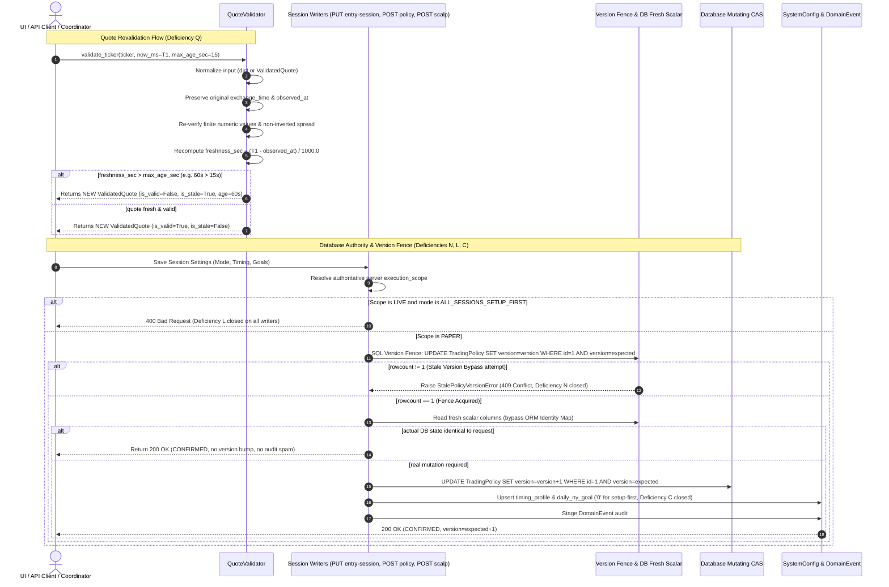

# AURUM V17.4.2 — Implementation Map & Architecture Specification

**Repository:** `quocan050302/Build-app-crypto`  
**Branch:** `fix/v14-1-rr-flow`  
**Baseline SHA:** `c112a4aa1c365ad1e78a047f8fca61517c4d96c5`  
**Target Commit:** `fix(v17.4.2): revalidate execution quotes and close session writer bypasses`  
**Scope:** Quote Revalidation / No-Op Concurrency / Session Writers (Zero strategy alteration, zero threshold loosening, zero NY preference/reservation)

---

## 1. High-Level Call Flow Architecture

---

## 2. Component & Function Implementation Matrix

| File | Function / Symbol | Type | Callers | Contract & Invariant | Test Reference | Status |
|---|---|---|---|---|---|---|
| `backend/services/quote_validator.py` | `_normalize_ticker_input` | [MỚI] | `validate_ticker` | Normalizes `Mapping` or `ValidatedQuote` to canonical dictionary with original `observed_at` and `exchange_time` without mutation | `test_v17_4_2_quote_revalidation.py::test_q01_raw_and_dto_fresh_parity` | VERIFIED |
| `backend/services/quote_validator.py` | `QuoteValidator.validate_ticker` | [HIỆN CÓ] (Refactored) | `ExecutionCoordinator`, `read_canonical_quote`, tests | Removed `if isinstance(ticker, ValidatedQuote): return ticker`. Recomputes freshness against caller `now_ms` and `max_age_sec`. Non-finite/inverted spreads rejected. | `test_v17_4_2_baseline_probes.py::test_prevalidated_quote_must_be_rechecked_at_execution_time` | VERIFIED |
| `backend/services/entry_session_policy_service.py` | `apply_entry_session_update_plan` | [HIỆN CÓ] (Refactored) | `update_entry_session_settings` | Eliminated ORM cached entity comparison before CAS. Executes SQL same-value version fence (`UPDATE ... SET version=version WHERE id=... AND version=expected`). Reads scalar columns directly. Raises 409 on version mismatch. | `test_v17_4_2_baseline_probes.py::test_cached_noop_must_reject_stale_expected_version` | VERIFIED |
| `backend/services/trading_policy_service.py` | `TradingPolicyService.update_policy` | [HIỆN CÓ] (Hardened) | `POST /api/v1/policy/trading` | Resolves server execution scope before mutation. Rejects `ALL_SESSIONS_SETUP_FIRST` under server `LIVE` scope with `ValueError`. | `test_v17_4_2_baseline_probes.py::test_legacy_policy_route_cannot_bypass_server_live_scope` | VERIFIED |
| `backend/policy_constants.py` | `validate_trading_policy_update` | [HIỆN CÓ] (Hardened) | `TradingPolicyService.update_policy` | Enforces paired invariants for `ALL_SESSIONS_SETUP_FIRST`: omitted goals default to 0/False, explicit non-zero raises `ENTRY_SESSION_CONFIG_CONFLICT`. | `test_v17_4_2_writer_contracts.py::test_w05_explicit_goal_1_conflict` | VERIFIED |
| `backend/main.py` | `update_scalp_config_endpoint` | [HIỆN CÓ] (Hardened) | `POST /api/scalp/config` | Enforces server scope check for `CG01_ALL_SESSIONS_PAPER`. Rejects explicit `daily_ny_goal != 0` under setup-first with 400. Replaces stale `ny_g` read with `eff_ny_g = 0`. | `test_v17_4_2_baseline_probes.py::test_legacy_scalp_route_rejects_conflicting_pair` | VERIFIED |
| `backend/services/execution_coordinator.py` | `evaluate_orders_sync` | [HIỆN CÓ] | `ScalpWatcherOrchestrator`, tests | Evaluates orders using `QuoteValidator.validate_ticker` with current clock time, rejecting stale or corrupted quotes at fill trigger boundary. | `test_v17_4_2_quote_execution.py::test_qe01_raw_fresh_long_trigger_fills` | VERIFIED |

---

## 3. Transaction Ownership and Invariants

1. **Transaction Boundary:**
   `update_entry_session_settings` owns the transaction. It enforces the SQL version fence, reads fresh scalars, determines whether a mutation is needed, executes mutating CAS, upserts `timing_profile` and `daily_ny_goal`, stages DomainEvent audit, and commits once.
2. **Version Fence Semantics:**
   `UPDATE TradingPolicy SET version=version WHERE id=:id AND version=:expected` acquires the write lock in SQLite without altering business data. If another transaction has committed a new version, `fence_result.rowcount == 0` causes immediate rollback and raises `StalePolicyVersionError`.
3. **Identity Map Bypass:**
   Scalars are fetched via `select(columns).where(id == ...)` to ensure values reflect committed database state rather than stale in-memory ORM identity map instances.
4. **Scope Authority on All 3 Writers:**
   - `PUT /api/v1/policy/entry-session`
   - `POST /api/v1/policy/trading`
   - `POST /api/scalp/config`
   All three routes verify `resolve_server_execution_scope(db)` and reject `ALL_SESSIONS_SETUP_FIRST` or `CG01_ALL_SESSIONS_PAPER` when server scope is `LIVE`.
5. **Zero NY Goal Invariant:**
   `ALL_SESSIONS_SETUP_FIRST` strictly mandates `ny_min_fills = 0`, `daily_ny_goal = '0'`, `reserve_ny_slot = False`, `ny_fallback_enabled = False`. Any conflicting explicit values are rejected with HTTP 400 `ENTRY_SESSION_CONFIG_CONFLICT`.
