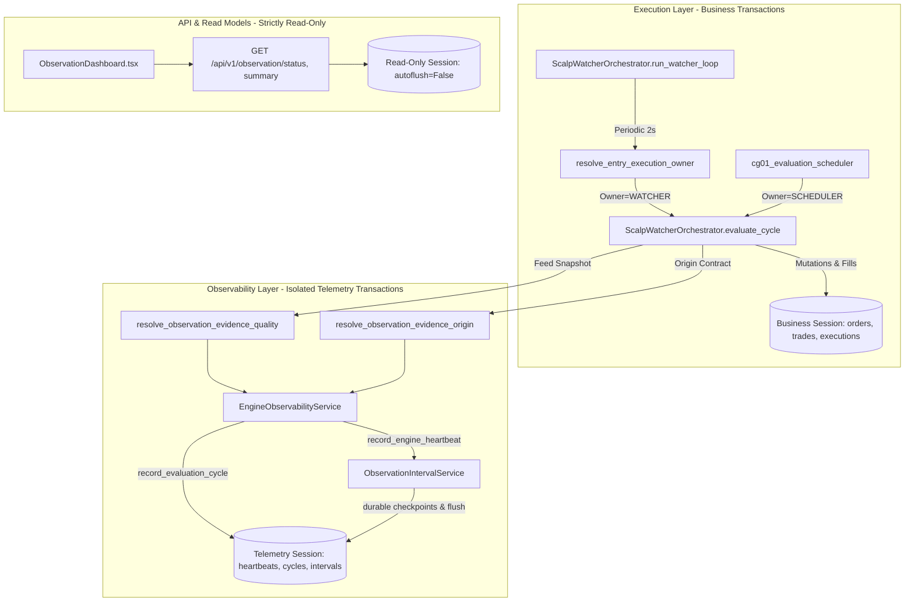

# AURUM DESK V17.6.4.1 — RUNTIME CALL GRAPH & TRANSACTION AUDIT

## 1. Executive Overview

This document details the runtime call graph, database transaction boundaries, ownership arbitration, and telemetry isolation across the AURUM XAUUSDT paper trading engine.

---

## 2. Telemetry Producers & Callers

### 2.1 Watcher Watchdog Heartbeat
- **Caller**: `ScalpWatcherOrchestrator.run_watcher_loop` (`backend/services/scalp_watcher_orchestrator.py`)
- **Cadence**: Every 2 seconds.
- **Worker Role**: `WATCHER_PROCESS`
- **Ownership Check**: Arbitrated by `resolve_entry_execution_owner(cg01_evaluation_scheduler, db=db)`.
- **Feed Evidence Contract**: Authoritative quote inspection using `build_market_feed_health_snapshot` / `capture_cg01_quote_snapshot`.
  - If feed is missing or unverified: `coverage_quality = UNVERIFIED`.
  - If feed is disconnected or stale: `coverage_quality = DEGRADED`.
  - Only when quote is fresh, structurally valid, and transport connected: `coverage_quality = GOOD`.

### 2.2 Cycle Start & Completion Heartbeat
- **Caller**: `ScalpWatcherOrchestrator.evaluate_cycle`
- **Cadence**: On demand or scheduled by evaluation owner.
- **Worker Role**: `EVALUATION_OWNER`
- **Evidence Origin**: Passed explicitly as `ObservationEvidenceOrigin` (`LIVE_FORWARD`, `REPLAY`, `TEST`).
- **Telemetry Boundaries**:
  - Cycle start records process and evaluation start time.
  - Cycle completion records duration, decisions, opportunities, armed orders, and updates heartbeat.

### 2.3 Evaluation Cycle Telemetry Writer
- **Caller**: `EngineObservabilityService.record_evaluation_cycle`
- **Database Session**:
  - Independent session bound to caller's engine or fallback `SessionLocal`.
  - Transaction committed or rolled back independently from business trading sessions.
  - In-memory diagnostics updated ONLY when database persistence status is confirmed.

---

## 3. Transaction Boundaries & Isolation

| Boundary | Session Lifecycle | Commit Policy | Rollback Policy | Fallback / Isolation |
|---|---|---|---|---|
| **Business Session** (`db`) | Created per request or worker loop | Committed on successful trade/order action | Rolled back on execution exception | Isolated from telemetry failure |
| **Telemetry Session** (`target_db`) | Created via `_resolve_target_session(db)` with independent connection | Committed immediately upon record write | Rolled back on write collision or SQLite busy | Does not taint or roll back business transaction |
| **Interval Producer** (`ObservationIntervalService`) | Session opened per checkpoint or batch flush | Committed on interval closure | Rolled back on write error; pending evidence preserved in-memory for retry | Memory tracker start time advanced ONLY after confirmed commit |
| **Read Model** (`main.py` endpoints) | Session dependency `Depends(get_db)` | Zero commits (`autoflush=False`) | Closed at request completion | Strictly read-only |

---

## 4. Evidence Origin Arbitration Matrix

| Origin | Generates Live Interval? | Increments Live Heartbeat? | Appears in Live Dashboard? | Telemetry Scope |
|---|---|---|---|---|
| `LIVE_FORWARD` | **YES** (if feed is GOOD/DEGRADED) | **YES** | **YES** | Production forward paper monitoring |
| `REPLAY` | **NO** (Strictly filtered) | **NO** (Isolated context) | **NO** | Backtest / Simulation journal only |
| `TEST` | **NO** (Strictly filtered) | **NO** (Isolated test mock) | **NO** | Automated test fixtures |
| `UNKNOWN` | **NO** (Fails closed) | **NO** (Logged warning) | **NO** | Rejected |

---

## 5. Summary of Invariants
1. **Business Isolation**: A database lock or failure in telemetry recording MUST NEVER cause a trading order to fail or roll back business state.
2. **Telemetry Durability**: An in-memory interval MUST NEVER be discarded or advanced until the underlying SQLite/Postgres record is committed.
3. **No False Good**: A process heartbeat without verified fresh quote evidence MUST NEVER generate a `GOOD` observation interval.
4. **Replay Isolation**: Replay operations running against the same database engine MUST NEVER increment `cycles_count` or generate live forward observation intervals.
