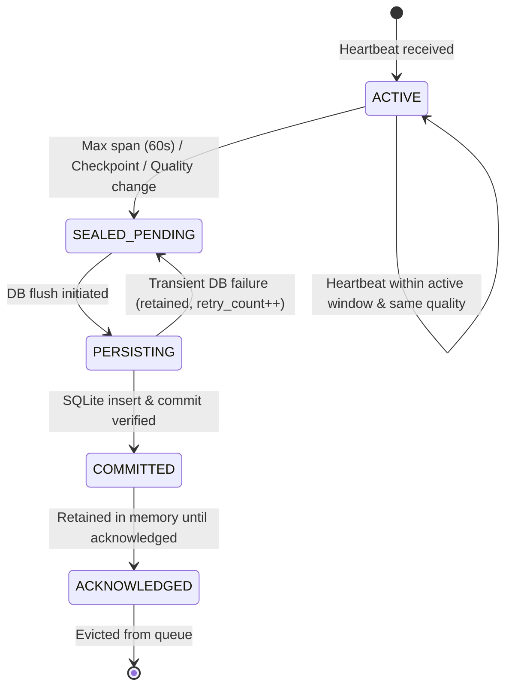

# AURUM DESK — V17.6.4.2 OBSERVATION INTERVAL STATE MACHINE
## Durable Multi-Phase Evidence Commitment Architecture

**Document Version:** 1.0.0  
**Target Release:** V17.6.4.2  
**Baseline SHA:** `f033d4aa69aef03901ab672173b24c8df236b35e`  
**Classification:** Core Telemetry Architecture · Zero Evidence Loss · Fail-Closed State Machine

---

### 1. Executive Summary & Defect Remediation

In prior versions (V17.6.4.1 and earlier, **ECI-01**), when an active observation interval reached its rotation trigger (maximum span of 60 seconds, periodic checkpoint, or quality transition), it was popped from in-memory tracking and database persistence was attempted immediately. If the database was busy, locked by concurrent SQLite writers, or failed during the transaction, the in-memory interval was discarded, resulting in an unrecoverable gap in the 7–14-day continuous observation ledger.

V17.6.4.2 introduces a strictly sealed, durable 5-phase pending interval state machine within [`ObservationIntervalService`](file:///Users/macbook/Documents/Project_Github/Build-app-crypto/aurum-desk/backend/services/observation_interval_service.py). Under this architecture, no interval is ever removed from in-memory recovery tracking until after a verified, independent database commit has completed.

---

### 2. State Machine Lifecycle



#### Phase Definitions

1. **`ACTIVE`**:
   The interval is currently aggregating continuous ticks and heartbeats for the designated `(run_id, symbol, scope)`. Quote statistics, sample counts, and timestamps are accumulated.
2. **`SEALED_PENDING`**:
   The interval has closed. It is frozen against new tick accumulation and assigned a unique composite pending key. It is queued in `_pending_intervals`.
3. **`PERSISTING`**:
   An active database session has acquired the interval and begun execution of the idempotent insert statement.
4. **`COMMITTED`**:
   The database engine has confirmed durable write and transaction commit. The record exists on disk.
5. **`ACKNOWLEDGED`**:
   The observation telemetry system has verified downstream readback or confirmed zero outstanding recovery requirements. The interval is safely retired from RAM.

---

### 3. Pending Queue Composite Identity Contract

To eliminate collisions across workers, run environments, and quality shifts (**ECI-12**), the pending key is computed as an immutable composite tuple:

$$\text{Key} = \langle \text{run\_id}, \text{symbol}, \text{scope}, \text{start\_ms}, \text{end\_ms}, \text{data\_quality}, \text{evidence\_origin}, \text{worker\_role}, \text{engine\_instance\_id} \rangle$$

```python
def _make_pending_key(self, record: Dict[str, Any]) -> str:
    return (
        f"{record.get('run_id')}:"
        f"{record.get('symbol')}:"
        f"{record.get('scope')}:"
        f"{record.get('start_ms')}:"
        f"{record.get('end_ms')}:"
        f"{record.get('data_quality')}:"
        f"{record.get('evidence_origin')}:"
        f"{record.get('worker_role')}:"
        f"{record.get('engine_instance_id')}"
    )
```

---

### 4. Retry & Failure Recovery Mechanics (**ECI-13**)

When transient SQLite errors (`OperationalError: database is locked`, `disk I/O error`, or connection resets) occur during `persist_pending_intervals`:

1. The transaction is immediately rolled back via `db.rollback()`.
2. The failing interval entry is reverted to `SEALED_PENDING` with its `retry_count` incremented and `last_error` recorded.
3. The interval remains in `_pending_intervals`.
4. Subsequent calls to `persist_pending_intervals()` or subsequent watcher cycles automatically re-attempt persistence.
5. `get_pending_metrics(run_id=None)` reports `pending_count`, `retry_count`, and `failed_count`.
6. Health monitors inspect `pending_count > 0` and transition `evidence_persistence_status` to `DEGRADED`, alerting the operator without losing data.

---

### 5. Verification Test Matrix

| Test ID | Scenario | Expected Invariant | Status |
|---|---|---|---|
| `PI01` | Normal rotation | Transitions `ACTIVE` -> `SEALED_PENDING` -> `COMMITTED` | **PASS** |
| `PI02` | DB locked on rotation | Interval retained in `_pending_intervals`, retry succeeds on next cycle | **PASS** |
| `PI03` | Quality shift (GOOD -> DEGRADED) | Active sealed cleanly; new active created with new quality | **PASS** |
| `PI04` | Max span reached (60s) | Rotation seals interval without dropping any ticks | **PASS** |
| `PI05` | Idempotency on duplicate flush | Duplicate insert ignored, no duplicate rows created | **PASS** |
| `PI06` | Multi-worker concurrency | Composite keys prevent worker collisions | **PASS** |
| `PI07` | Metrics readback | Accurately counts pending, committed, and retried intervals | **PASS** |
