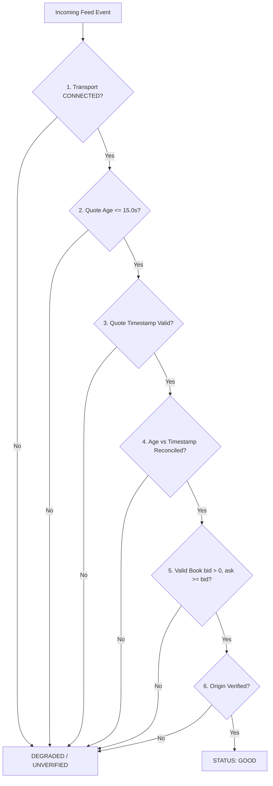

# AURUM DESK — V17.6.4.2 QUOTE AUTHORITY CONTRACT
## Fail-Closed Market Feed Quality & Anti-Bypass Architecture

**Document Version:** 1.0.0  
**Target Release:** V17.6.4.2  
**Baseline SHA:** `f033d4aa69aef03901ab672173b24c8df236b35e`  
**Classification:** Feed Telemetry Contract · Strict Freshness Enforcement · Fail-Closed Authority

---

### 1. Executive Summary & Defect Remediation

In prior releases (V17.6.4.1 and earlier, **ECI-02** & **ECI-08**):
1. `resolve_observation_evidence_quality()` failed open: if `quote_age_sec` was missing (`None`), transport state was `UNKNOWN`, or quote timestamp was omitted, the feed quality was permitted to evaluate to `GOOD`.
2. Metadata flags passed to `record_engine_heartbeat()` could bypass evaluation entirely if caller metadata included `coverage_quality: "GOOD"` or `is_feed_healthy: True`.
3. Contradictory quote age vs quote timestamp (`last_quote_at_ms`) was not reconciled, permitting stale or unverified quotes to mask connectivity outages.

V17.6.4.2 establishes an uncompromising, fail-closed quote authority contract implemented in [`EngineObservabilityService.resolve_observation_evidence_quality()`](file:///Users/macbook/Documents/Project_Github/Build-app-crypto/aurum-desk/backend/services/engine_observability_service.py). Under this contract, `GOOD` quality is impossible unless all positive verification proofs are satisfied.

---

### 2. The 6-Point Authoritative Verification Contract

To attain `data_quality = "GOOD"`, every one of the following conditions MUST evaluate to `True`:

#### Detailed Contract Rules

1. **Transport State Authority**:
   - `transport_state` must be strictly `"CONNECTED"`.
   - `UNKNOWN`, `DISCONNECTED`, `CONNECTING`, or `RECONNECTING` fail closed to `DEGRADED` (or `UNVERIFIED` if no sample exists).
2. **Quote Age Authority**:
   - `quote_age_sec` must be present, finite, non-negative ($0.0 \le \text{age} \le 15.0\,\text{s}$).
   - Any quote older than $15.0$ seconds immediately fails to `DEGRADED`.
3. **Timestamp Freshness Authority**:
   - `last_quote_at_ms` must be present, finite, and non-zero.
   - Future timestamps exceeding clock skew allowance ($> 1000\,\text{ms}$ in the future) are rejected.
4. **Timestamp vs Age Reconciliation**:
   - The discrepancy between time elapsed since `last_quote_at_ms` and `quote_age_sec` must not exceed $2.0$ seconds:
     $$|\,(now\_ms - last\_quote\_at\_ms) - (quote\_age\_sec \times 1000)\,| \le 2000\,\text{ms}$$
   - Any conflict indicates simulated, desynchronized, or corrupted quote metadata.
5. **Order Book Sanity & Crossed Book Rejection**:
   - Bids and asks must be positive numbers ($bid > 0, ask > 0$).
   - Crossed books ($ask < bid$) are invalid market structures and fail closed to `DEGRADED`.
6. **Metadata Bypass Prevention (**ECI-08**)**:
   - Callers passing unverified flags (e.g., `metadata={"coverage_quality": "GOOD"}`) without underlying verified transport/quote telemetry are stripped and demoted to `UNVERIFIED`.

---

### 3. Classification Truth Table

| Transport | Quote Age | Last Quote MS | Ask vs Bid | Result Quality | Rationale |
|---|---|---|---|---|---|
| `CONNECTED` | `0.4s` | $now - 400$ | $ask \ge bid > 0$ | **`GOOD`** | All criteria satisfied |
| `DISCONNECTED` | `0.4s` | $now - 400$ | $ask \ge bid > 0$ | **`DEGRADED`** | Transport disconnected |
| `CONNECTED` | `18.2s` | $now - 18200$ | $ask \ge bid > 0$ | **`DEGRADED`** | Quote age exceeds 15.0s threshold |
| `CONNECTED` | `None` | $now - 400$ | $ask \ge bid > 0$ | **`UNVERIFIED`** | Missing quote age |
| `CONNECTED` | `0.4s` | `None` | $ask \ge bid > 0$ | **`UNVERIFIED`** | Missing timestamp |
| `CONNECTED` | `0.2s` | $now - 10000$ | $ask \ge bid > 0$ | **`DEGRADED`** | Age / timestamp conflict ($9.8s > 2s$) |
| `CONNECTED` | `0.4s` | $now - 400$ | $ask < bid$ | **`DEGRADED`** | Crossed order book |
| `UNKNOWN` | `None` | `None` | `None` | **`UNVERIFIED`** | Initial / cold start state |

---

### 4. Verification Test Matrix

- **`QA01 - QA18`** (`test_v17_6_4_2_quote_authority.py`):
  Covers boundary conditions, crossed books, timestamp skew, reconciliation thresholds, and missing fields. (18/18 PASS)
- **`MB01 - MB03`** (`test_v17_6_4_2_metadata_good_bypass.py`):
  Covers unverified metadata injection, mock bypass prevention, and strict fail-closed resolution. (3/3 PASS)
