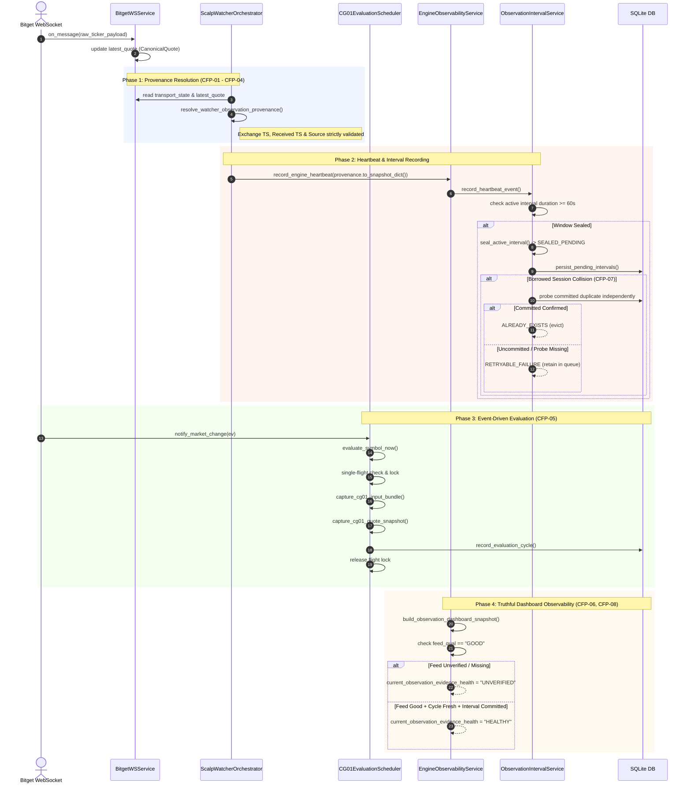

# AURUM V17.6.4.3b — RUNTIME CALL GRAPH & DATA FLOW ARCHITECTURE
**Version:** V17.6.4.3b  
**Scope:** Feed Provenance, Scheduler Pipeline, Observability, and Transaction Durability Call Graphs  
**Architect:** Principal Quantitative Systems Engineer  

---

## 1. Feed-to-Cycle Call Graph

---

## 2. Component Responsibility Matrix

| Component | Responsibility | Fault-Isolation Guarantees |
|---|---|---|
| `BitgetWSService` | Raw transport, ping/pong, heartbeat, auto-reconnect, connection epoch | Disconnected socket never reports connected |
| `ScalpWatcherOrchestrator` | Watcher execution loop, provenance resolution, strategy cycle evaluation | Fails closed on missing timestamps or unknown source |
| `CG01EvaluationScheduler` | Event-driven candle change evaluation, single-flight per symbol, input bundling | Deterministic clock, shadow mode isolation, clean lock release |
| `ObservationIntervalService` | Rolling 60s window tracking, sealing, multi-DB pending queue, readback durability probe | Uncommitted duplicate remains retried; never prematurely evicted |
| `EngineObservabilityService` | Multi-tier health snapshots, coverage calculations, audit trail reporting | Feed quality gating: UNVERIFIED feed cannot produce HEALTHY status |
