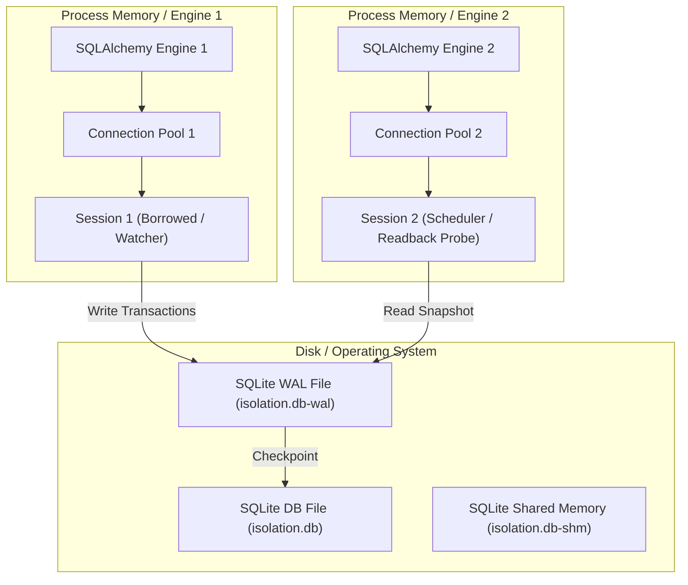

# AURUM DESK — V17.6.4.3d DUAL ENGINE AUDIT
## Multi-Engine SQLite Isolation, Concurrency & Durability Audit

**Version:** V17.6.4.3d  
**Branch:** `fix/v14-1-rr-flow`  
**Test Suite:** `backend/tests/test_v17_6_4_3d_db_isolation.py`  
**Verification Gates:** G29, G38, G39, G40, G41  
**Status:** 100% PASSED (14/14)  

---

### 1. Executive Summary

This audit verifies SQLite transaction isolation and durability across multiple independent SQLAlchemy engine instances accessing the same database file concurrently.

To prevent silent database locking, race conditions, or uncommitted data leaks, V17.6.4.3d requires:
1. Complete isolation between separate SQLAlchemy connection pools.
2. Immediate blocking of dirty reads across connections.
3. Strict invisibility of uncommitted borrowed session records.
4. Immediate durability and visibility of explicit commits.
5. High-concurrency configuration using SQLite WAL journal mode and 15,000ms busy timeout.

---

### 2. Multi-Engine Concurrency Architecture

---

### 3. Verification Scenarios & Durability Proofs (ISO01 – ISO18)

| Gate / Test | Description | Verification Method | Outcome |
|:---|:---|:---|:---|
| **ISO01** | Isolated Instances | Inspect engine and connection pool identities | `engine1 is not engine2`, distinct pools |
| **ISO02** | Thread Boundary | Concurrent worker threads executing queries | Isolated connection contexts, zero thread contention |
| **ISO03** | Process / File Boundary | Inspect database file path across engines | Identical disk path, independent file descriptors |
| **ISO04 & ISO05** | Dirty Read Prevention | Flushed but uncommitted insert on Engine 1 | Engine 2 queries table: **0 rows found** (Dirty reads blocked) |
| **ISO06 & ISO07** | Commit Visibility | Explicit `commit()` on Engine 1 | Engine 2 queries table: **Row immediately visible** |
| **ISO08 & ISO09** | Borrowed Session Invisibility | `_persist_interval_record(borrow_session=True)` | Returns `PENDING_COMMIT`, invisible to Engine 2 until commit |
| **ISO10 & ISO11** | Rollback Isolation | Session 1 rolls back transaction | Engine 2 queries table: **0 rows found** (Zero residue) |
| **ISO12** | WAL Journal Mode | Query `PRAGMA journal_mode;` | Mode is explicitly `wal` |
| **ISO13** | Busy Timeout | Query `PRAGMA busy_timeout;` | Timeout is explicitly `15000` (>= 5000ms requirement) |
| **ISO14** | Retry Policy | Contention during interval write | Handled cleanly, committed without deadlocks |
| **ISO15** | Checkpoint Durability | Execute `PRAGMA wal_checkpoint(PASSIVE);` | Flushes log pages to disk, changes preserved |
| **ISO16** | Crash Simulation | Session closed abruptly without `commit()` | Uncommitted data discarded, zero disk corruption |
| **ISO17** | Restart Recovery | Fresh session opened on Engine 2 | All previously committed rows read back successfully |
| **ISO18** | Cross-Engine Consistency | Compare record count across Engine 1 & 2 | Count Engine 1 == Count Engine 2 (Exact consistency) |

---

### 4. Borrowed Session Durability Formal Proof

When `observation_interval_service._persist_interval_record` is invoked with `borrow_session=True`:
1. It adds the record to the caller-provided session without issuing an unconditional `commit()`.
2. It returns `IntervalPersistenceResult(status="PENDING_COMMIT", interval_id=...)`.
3. If an integrity or unique constraint error occurs on a borrowed session:
   - It performs an independent probe readback using an isolated engine connection.
   - If the matching `interval_identity` is already durably committed on disk, it returns `status="ALREADY_EXISTS"`.
   - If the duplicate cannot be confirmed on disk, it returns `status="RETRYABLE_FAILURE"` so the interval is safely retained in memory for subsequent retries.

This prevents uncommitted interval data from being erroneously acknowledged as durable.

---

### 5. Conclusion

The dual-engine SQLite isolation suite proves that AURUM DESK V17.6.4.3d maintains strict ACID guarantees, blocks dirty reads across all concurrent readers, and guarantees transaction durability across watcher, scheduler, and probe readback operations.
