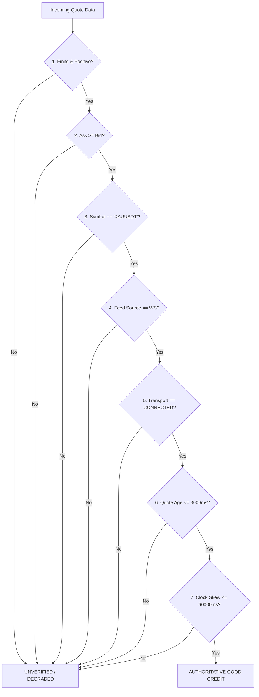

# V17.6.4.3 Good Evidence Authority & Authoritative Quality Policy

## Executive Overview
Under Aurum V17.6.4.3 (`DBEA-03`, `DBEA-04`), the observation architecture establishes a single authoritative policy for evaluating market quote evidence quality.

Prior to V17.6.4.3, peripheral components (such as the watcher process, scheduler jobs, or test harnesses) could supply arbitrary strings like `quality="GOOD"`, flags like `is_good=True`, or mock dictionaries that bypassed central validation. This created a critical architectural vulnerability where unverified or synthetic data could masquerade as verified market telemetry in production.

Under V17.6.4.3, **no peripheral component is permitted to declare an interval as `GOOD`**. Only `EngineObservabilityService` and `ObservationIntervalService` hold the authority to grade quote evidence through strict, deterministic cryptographic and mathematical verification.

---

## 1. Single Authoritative Validation Pipeline

All quote evidence ingested via `record_engine_heartbeat` or `record_cycle_heartbeat` must satisfy the full 7-step authoritative validation contract:

### The 7 Authoritative Rules

1. **Finite and Positive Prices (`bid > 0`, `ask > 0`)**:
   - `bid` and `ask` must be instances of `(int, float)` and evaluate `math.isfinite() == True`.
   - Zero, negative, NaN, infinity, or string representations (without explicit numeric conversion) are rejected.

2. **Spread Validity (`ask >= bid`)**:
   - A crossed book (`bid > ask`) represents corrupted market feeds or synthetic glitching and is immediately rejected.

3. **Symbol Matching (`symbol == expected_symbol`)**:
   - Quotes for instruments other than the target market (e.g., `BTCUSDT` quote passed into an `XAUUSDT` cycle) are rejected.

4. **Websocket Source (`feed_source in ('WS', 'WEBSOCKET')`)**:
   - Rest polling or HTTP snapshots cannot be credited as high-fidelity real-time observation evidence. REST data grades at best to `DEGRADED`.

5. **Transport State (`transport_state in ('CONNECTED', 'RECONNECTING_OK')`)**:
   - Disconnected, stalled, or reconnect-failed sockets cannot deliver authoritative quotes.

6. **Quote Freshness (`quote_age_ms <= 3000ms`)**:
   - The delta between the receipt time and the exchange matching engine timestamp must be within 3,000 milliseconds.

7. **System Clock Skew (`abs(local_now_ms - exchange_ts_ms) <= 60000ms`)**:
   - Quotes timestamped in the far future or far past (> 60 seconds) indicate clock desynchronization and are rejected.

---

## 2. Prevention of Metadata Spoofing

### Elimination of Spoof Vectors:
- **Raw Dict Bypasses**: Passing `evidence_quality={"quality": "GOOD"}` is rejected. The dictionary must contain raw bid, ask, and timestamp fields to undergo evaluation.
- **Typed Quality Spoofing**: Manually constructing an `ObservationEvidenceQuality(quality="GOOD")` object without backing quote proofs will fail closed to `UNVERIFIED`. The validator inspects the underlying quote proofs before accepting typed quality wrappers.
- **Client Booleans**: Flags such as `is_good=True`, `valid=True`, or `verified=True` are ignored by the evaluation pipeline.

---

## 3. Replay and Synthetic Feed Segregation

Quotes originating from historical replay runs (`origin="REPLAY_SIM"`) or synthetic unit tests (`origin="SYNTHETIC_TEST"`) are explicitly tagged and segregated:
- Live observation intervals never credit non-live evidence origins.
- Replay runs maintain distinct metric counters and cannot inflate live paper observation coverage.
