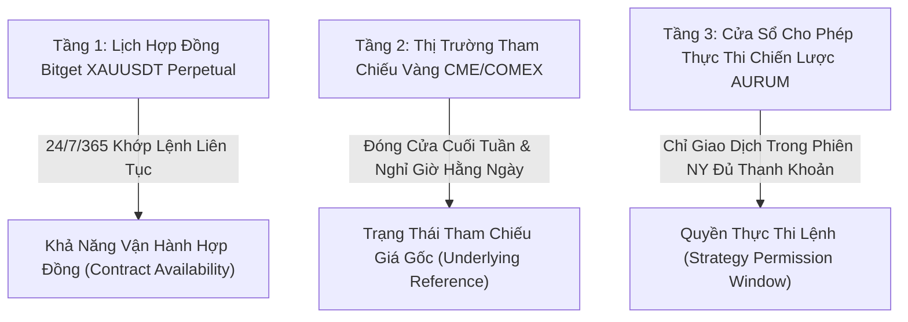

# HỢP ĐỒNG LỊCH THỊ TRƯỜNG & PHÂN LẬP CƠ CHẾ BÁO GIÁ
## AURUM DESK — PHIÊN BẢN V17.6.4 (Phase M, PART 161)

---

### 1. MỤC ĐÍCH & PHẠM VI HỢP ĐỒNG (PURPOSE & SCOPE)

Tài liệu này xác lập ranh giới định danh bất biến (invariants) về cơ chế lịch thị trường, phiên giao dịch và thẩm quyền thực thi đối với cặp giao dịch **XAUUSDT** trong hệ thống AURUM V17.6.4.

Trước V17.6.4, hệ thống gộp chung lịch đóng mở cửa của thị trường tương lai vàng truyền thống (CME/COMEX) vào hợp đồng tương lai vĩnh cửu crypto (Bitget USDT-M Perpetual). Sai lầm này dẫn đến:
1. Nhầm lẫn rằng hợp đồng Bitget XAUUSDT đóng cửa vào thứ Bảy và Chủ Nhật.
2. Ép buộc động cơ quan sát chuyển sang trạng thái `WAITING_MARKET` vào cuối tuần dù hợp đồng Bitget vẫn nhận lệnh và khớp lệnh bình thường 24/7.
3. Làm biến dạng mẫu số độ bao phủ quan sát (observation coverage denominator), gán nhãn sai lệch cho thời gian cuối tuần là "giờ đóng cửa được miễn trừ".

---

### 2. PHÂN TÁCH 3 TẦNG THỊ TRƯỜNG & PHIÊN GIAO DỊCH (THREE-TIER CALENDAR SEPARATION)

Trong V17.6.4, hệ thống tách bạch tuyệt đối 3 tầng khái niệm:

#### 2.1. Tầng 1: Lịch Khả Dụng Hợp Đồng Bitget (`CONTRACT_TRADING_AVAILABILITY`)
- **Đối tượng**: Hợp đồng Bitget USDT-FUTURES `XAUUSDT`.
- **Lịch trình**: **24/7/365** liên tục, không có ngày nghỉ cuối tuần theo đặc tả chính thức của Bitget (`BITGET_PRODUCT_SPEC`).
- **Ngoại lệ duy nhất**: Bảo trì hệ thống đột xuất của sàn giao dịch (được gắn cờ qua thông báo hạ tầng hoặc mất kết nối mạng).
- **Mẫu số bao phủ (Coverage Denominator)**: Toàn bộ thời gian trôi qua thực tế trong phiên quan sát (`elapsed_ms`), không trừ cuối tuần.

#### 2.2. Tầng 2: Phiên Tham Chiếu Vàng Truyền Thống CME/Spot (`UNDERLYING_REFERENCE_SESSION`)
- **Đối tượng**: Thị trường vàng quốc tế cơ sở (CME Globex GC / XAUUSD Spot).
- **Lịch trình hoạt động**:
  - Mở cửa tuần: Chủ Nhật 18:00 New York (ET).
  - Đóng cửa tuần: Thứ Sáu 17:00 New York (ET).
  - Giờ bảo trì kỹ thuật hàng ngày: 17:00 - 18:00 New York (ET) từ thứ Hai đến thứ Năm.
  - Kỳ nghỉ cuối tuần: Thứ Sáu 17:00 ET đến Chủ Nhật 18:00 ET.
- **Quy tắc Daylight Saving Time (DST)**:
  - Tự động chuyển đổi theo múi giờ `America/New_York` qua thư viện chuẩn `zoneinfo.ZoneInfo("America/New_York")`.
  - Spring Forward: Chủ Nhật thứ 2 của tháng 3 (UTC-5 -> UTC-4).
  - Fall Back: Chủ Nhật đầu tiên của tháng 11 (UTC-4 -> UTC-5).
- **Ảnh hưởng đến Telemetry**: Cung cấp ngữ cảnh giải thích vì sao thanh khoản hoặc biến động giá có thể thấp vào cuối tuần do thị trường cơ sở đang đóng cửa.

#### 2.3. Tầng 3: Cửa Sổ Cho Phép Thực Thi Chiến Lược AURUM (`STRATEGY_EXECUTION_SESSION`)
- **Đối tượng**: Mô hình vào lệnh SMC/ICT Scalp CG01 của AURUM Desk.
- **Quy tắc an toàn**: Mặc dù sàn mở 24/7, bot chỉ cho phép ARM lệnh mới trong phiên New York (08:00 - 17:00 ET) khi có đủ cấu trúc thanh khoản và độ biến động tin cậy.
- **Phân định rõ ràng**: Khi ngoài phiên NY, lý do không vào lệnh được xếp loại chính xác là `OUTSIDE_STRATEGY_SESSION` (Chiến lược chủ động đứng ngoài), KHÔNG được khai báo gian dối là "sàn đóng cửa" (`MARKET_CLOSED`).

---

### 3. CƠ CHẾ PHẢN ÁNH TELEMETRY & API STATUS TRUNG THỰC

1. **API `/api/v1/observation/status` và `/summary`**:
   - `feed.contract_schedule`: Giá trị cố định `"24_7"`.
   - `feed.contract_operational_state`: `"OPEN"` (hoặc `"EXCHANGE_MAINTENANCE"`).
   - `feed.underlying_reference_state`: `"OPEN"`, `"DAILY_MAINTENANCE"`, hoặc `"CLOSED_WEEKEND_BREAK"`.
   - `feed.strategy_session_state`: `"ACTIVE_IN_SESSION"` hoặc `"DISABLED_OUTSIDE_WINDOW"`.

2. **Quy tắc Trạng thái Bot Engine**:
   - Khi hợp đồng mở cửa 24/7 và luồng kết nối khỏe: Engine ở trạng thái `RUNNING`.
   - Cấm triệt để việc ép Engine về `WAITING_MARKET` vào thứ Bảy/Chủ Nhật khi đang kết nối với hợp đồng Bitget 24/7.

---

### 4. MA TRẬN NGHIỆM THU KIỂM THỬ TỰ ĐỘNG (VERIFICATION MATRIX)

| Test ID | Nội Dung Kiểm Thử | Trạng Thái Kỳ Vọng | Bộ Kiểm Thử | Kết Quả |
|:---|:---|:---:|:---|:---:|
| **CAL01** | Khả dụng lịch thứ Bảy 12:00 ET | `scheduled_open=True`, `schedule="24_7"` | `test_v17_6_4_contract_calendar.py` | **PASS** |
| **CAL02** | Khả dụng lịch Chủ Nhật 10:00 ET | `scheduled_open=True`, `schedule="24_7"` | `test_v17_6_4_contract_calendar.py` | **PASS** |
| **CAL03** | Đóng cửa thị trường cơ sở thứ Sáu 17:00 ET | `is_weekend_break=True`, `close_reason="WEEKEND_BREAK"` | `test_v17_6_4_contract_calendar.py` | **PASS** |
| **CAL04** | Mở cửa thị trường cơ sở Chủ Nhật 18:00 ET | `is_open=True`, `close_reason="OPEN"` | `test_v17_6_4_contract_calendar.py` | **PASS** |
| **CAL05** | Chuyển đổi giờ mùa hè New York (Spring DST) | Chuẩn xác theo mốc UTC tương ứng | `test_v17_6_4_contract_calendar.py` | **PASS** |
| **CAL06** | Chuyển đổi giờ mùa đông New York (Fall DST) | Chuẩn xác theo mốc UTC tương ứng | `test_v17_6_4_contract_calendar.py` | **PASS** |
| **CAL07** | Mất kết nối sàn giao dịch | `operational_status="EXCHANGE_OFFLINE"` | `test_v17_6_4_contract_calendar.py` | **PASS** |
| **CAL08** | Cặp giao dịch không hợp lệ | Fallback an toàn, fail-closed | `test_v17_6_4_contract_calendar.py` | **PASS** |
| **CAL09** | Nhận diện đúng loại sản phẩm `USDT-FUTURES` | Lịch 24/7 áp dụng riêng cho perpetual | `test_v17_6_4_contract_calendar.py` | **PASS** |
| **CAL10** | Chiến lược bị khóa ngoài phiên NY dù sàn mở | `strategy_session_state="DISABLED_OUTSIDE_WINDOW"` | `test_v17_6_4_contract_calendar.py` | **PASS** |
| **CAL11** | Giờ bảo trì kỹ thuật hàng ngày CME 17:00-18:00 ET | `close_reason="DAILY_MAINTENANCE"` | `test_v17_6_4_contract_calendar.py` | **PASS** |
| **CAL12** | Giá cơ sở đứng yên cuối tuần nhưng hợp đồng mở | Phân biệt `quote_stale` và `contract_schedule` | `test_v17_6_4_contract_calendar.py` | **PASS** |
