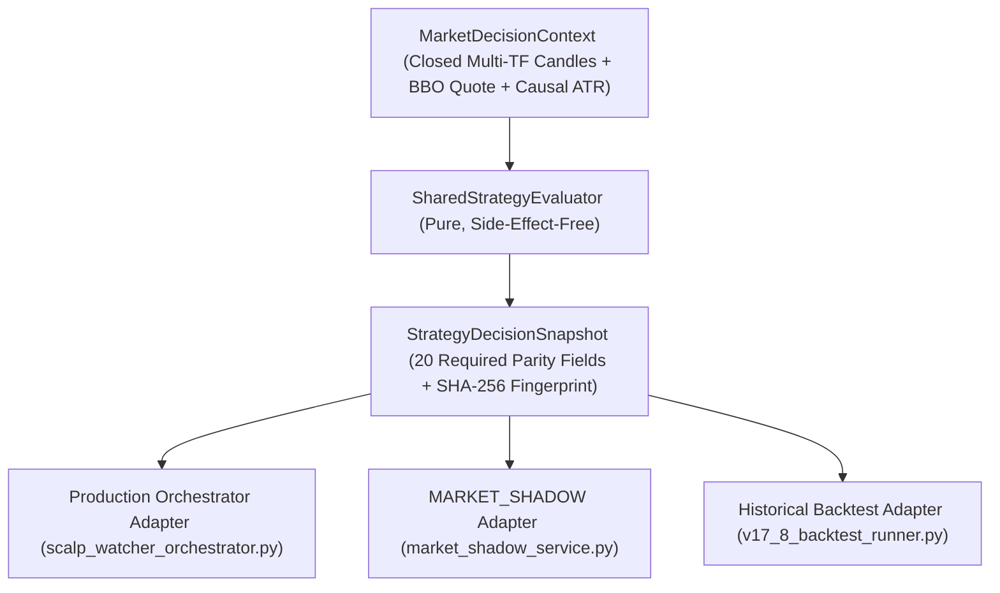

# AURUM DESK V17.9.0 — Shared Strategy Evaluator Architecture

- **Release Version**: `V17.9.0`
- **Branch**: `feat/v17-8-unicorn-structural-sl-tp-intelligence`
- **Tested Executable Source SHA (`FINAL_CODE_SHA`)**: `76f725a232ab3bda5459b40efad95a08dfca7fd1`
- **Core Modules**:
  - `backend/services/strategy_decision_contract.py`
  - `backend/services/shared_strategy_evaluator.py`

---

## 1. Architectural Overview

V17.9.0 extracts the pure, side-effect-free strategy decision pipeline into `SharedStrategyEvaluator` (`backend/services/shared_strategy_evaluator.py`) governed by the canonical contracts in `backend/services/strategy_decision_contract.py`.

All three runtime and research execution paths now consume the same authoritative evaluator:
1. **Production Orchestrator Adapter (`backend/services/scalp_watcher_orchestrator.py`)**:
   - `build_shared_decision_context()`, `evaluate_shared_decision_snapshot()`, `evaluate_shared_all_models()` (`adapter_origin="PRODUCTION_ORCHESTRATOR_ADAPTER"`).
2. **`MARKET_SHADOW` Adapter (`backend/services/market_shadow_service.py`)**:
   - `build_shared_decision_context()`, `evaluate_shared_decision_snapshot()`, `evaluate_shared_all_models()` (`adapter_origin="MARKET_SHADOW_ADAPTER"`), persisting `StrategyDecisionSnapshot` fields to isolated shadow storage without operational DB writes.
3. **Historical Backtest Adapter (`backend/services/v17_8_backtest_runner.py`)**:
   - `evaluate_production_parity_model_snapshot()` and `_extract_historical_opportunities_chronologically()` invoke `SharedStrategyEvaluator` directly (`adapter_origin="HISTORICAL_BACKTEST_ADAPTER"`) without calling `MarketShadowService`.

---

## 2. Canonical Contracts (`backend/services/strategy_decision_contract.py`)

### 2.1 `MarketDecisionContext`
Constructed via `build_market_decision_context()`:
- Filters all timeframe candles (`1M`, `5M`, `15M`, `1H`, `4H`) strictly to closed bars (`close_time <= decision_timestamp_ms`).
- Wraps candles in `_DualAccessCandle` supporting both dict and attribute access across all production engines (`smc_engine`, `scalp_m1_model_service`, `cg01_engine`, `unicorn_evidence_service`).
- Computes deterministic `candle_window_hashes` and `context_fingerprint`.
- Extracts authentic `atr_m1` and `atr_m5` (`atr_m5_source = "ACTUAL_CLOSED_M5"` or `"MISSING_M5_OMITTED"`).

### 2.2 `StrategyDecisionSnapshot` (20 Mandatory Parity Fields)
Every model/direction evaluation produces an immutable `StrategyDecisionSnapshot` containing all 20 required parity fields (`REQUIRED_PARITY_FIELDS`):
1. `model_id`
2. `direction`
3. `decision_timestamp_ms`
4. `setup_detected`
5. `decision_status` (`ELIGIBLE` or `REJECTED_*`)
6. `rejection_reason_code`
7. `entry_Reference_price`
8. `executable_entry_price`
9. `unicorn_valid`
10. `unicorn_reason_code`
11. `unicorn_causal_chain_valid`
12. `selected_stop_authority`
13. `structural_anchor_price`
14. `stop_buffer_price`
15. `final_stop_price`
16. `target_price`
17. `target_authority`
18. `quantity`
19. `net_rr`
20. `risk_budget_usdt`

Plus `decision_fingerprint` (deterministic SHA-256 over the canonical 20-field JSON representation).

